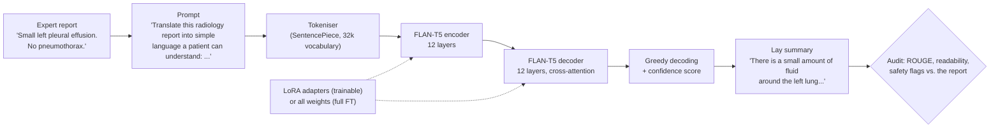
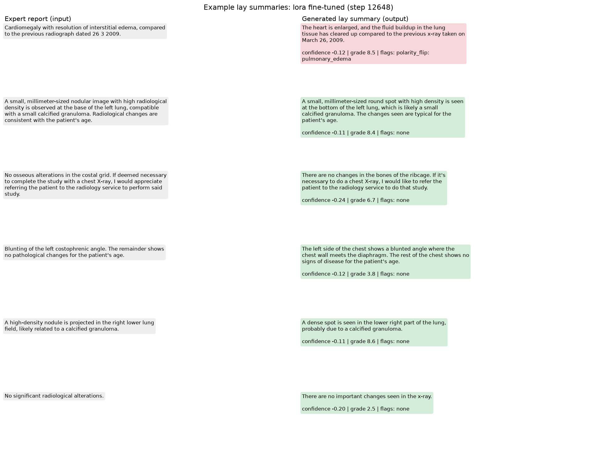
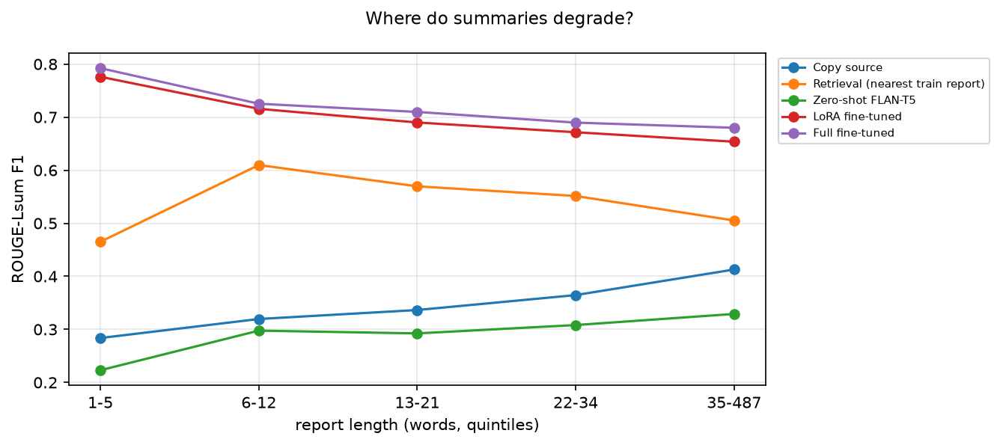

# Plain-Language Radiology Reports with FLAN-T5: LoRA vs. Full Fine-Tuning

**Aditya Raj Singh (48979519)**, COMP3710 Pattern Analysis 2026, Project 2.6: Radiology Report Summarisation (Hard difficulty, T5 / FLAN-T5)

Radiology reports are written for doctors ("Small left pleural effusion. No pneumothorax."), but patients now read them in online portals and are often left confused or worried. This project teaches **FLAN-T5-base** [2], an instruction-tuned encoder-decoder Transformer [1, 3], to rewrite chest X-ray reports in plain, patient-friendly language ("There is a small amount of fluid around the left lung. There is no collapsed lung."). It uses the BioLaySumm 2025 LaymanRRG data: about 150,000 expert reports, each paired with a lay version written by GPT-4o [8, 15]. Two ways of adapting the 248M-parameter model are compared. **Full fine-tuning** trains every weight. **LoRA** [4] freezes the model and learns two small low-rank matrices beside chosen layers, so only 1.77M parameters (0.71%) are trained. Both are measured against three baselines: the same model with no training (**zero-shot**), **copying the report** unchanged, and **retrieving** the lay summary of the most similar training report. A summary can score well on ROUGE while dropping or inventing a finding, so every summary is also checked for clinical errors (omitted, invented or negated findings, changed certainty, false reassurance), for readability, and for whether the model's confidence predicts its mistakes. Together these answer the task's question: *does fine-tuning keep the clinical facts right, or does it only make the text sound better?*

**How it works.** Each report is placed inside a fixed instruction ("Translate this radiology report into simple language a patient can understand: ...") and split into word pieces by the tokenizer. The encoder reads the whole prompt at once. The decoder then writes the lay summary one word piece at a time, looking back at the encoder through cross-attention, and always picks the most likely next piece (greedy decoding). Training shows the model the reference lay summary and lowers the cross-entropy of every next word piece. In LoRA mode only the small adapter matrices change, while full fine-tuning changes every weight. Each finished summary gets a confidence score (its average token log-probability) and is compared with the original report by a rule-based safety checker. In the proposed deployment, any summary the checker flags goes to a clinician instead of straight to the patient.



**One held-out example** (validation-5671, a report whose text never appears in the training data):

| | Summary | ROUGE-Lsum | Safety flags |
|---|---|---|---|
| **Expert report (input)** | Cardiomegaly. Laminar atelectasis in the left base. No areas of consolidation, ground-glass opacities, or pleural effusion are observed. | | |
| Zero-shot FLAN-T5 | The left base is a pleural effusion. | 0.143 | omission (enlarged heart), polarity flip (invents the effusion the report rules out) |
| LoRA fine-tuned | The heart is enlarged. There is a thin layer of collapsed lung at the bottom left part of the lung. No areas of lung thickening, hazy areas, or fluid around the lungs are seen. | 0.899 | none |
| Full fine-tuned | The heart is enlarged. There is a thin layer of collapsed lung at the bottom left. No areas of lung thickening, hazy lung opacities, or fluid around the lungs are seen. | 0.939 | none |
| Reference (GPT-4o) | The heart is enlarged. There is a thin layer of collapsed lung at the bottom of the left lung. No areas of solid lung thickening, hazy lung opacities, or fluid around the lungs are seen. | | |

**Results at a glance** (official validation split: 10,000 reports, 5,505 of them unseen in training):

| | Zero-shot | LoRA | Full fine-tuning | Reference (GPT-4o) |
|---|---|---|---|---|
| ROUGE-1 / ROUGE-Lsum | 0.309 / 0.289 | 0.732 / 0.702 | **0.749 / 0.720** | |
| ROUGE-Lsum on unseen reports | 0.306 | 0.671 | **0.692** | |
| Median reading grade (target ≤ 8) | 12.7 | **6.3** | 6.4 | 6.7 |
| Summaries with a safety flag (unseen reports) | 15.9% (see below) | **19.2%** | 20.1% | 22.3% (the checker's floor) |
| Disagrees with the reference summary on a critical finding | 21.3% | 13.2% | **12.4%** | |
| Trainable parameters / checkpoint size | 0 | 1.77M (0.71%) / **6.8 MB** | 247.6M / 1.1 GB | |
| Peak training VRAM / training time (one A100) | | **13.6 GB / 36 min** | 17.3 GB / 41 min | |

The zero-shot flag rate only looks low because 64.7% of its outputs are near-copies of the expert report. When it actually rewrites a report, 36.8% of its summaries are flagged.

**In short:** fine-tuning produces patient-level language and keeps the critical findings about as reliably as the reference summaries do. It also learns their mistakes (GPT-4o wrote them) and makes rare, confident slips that ROUGE cannot see: an invented enlarged heart still scores ROUGE-Lsum 0.94. The recommendation is LoRA, in a pilot where an entity-check guardrail decides which summaries are released and a clinician reviews the rest. It is not ready for fully automatic release ([Section 7.8](#78-recommendation-to-the-project-manager)).

---

## Contents
- [1. Problem and algorithm](#1-problem-and-algorithm)
- [2. Feasibility review (midpoint check-off)](#2-feasibility-review-midpoint-check-off)
- [3. Dependencies and reproducibility](#3-dependencies-and-reproducibility)
- [4. Data, pre-processing and splits](#4-data-pre-processing-and-splits)
- [5. Usage](#5-usage)
- [6. Training curves and example outputs](#6-training-curves-and-example-outputs)
- [7. Investigation of the open research dilemma](#7-investigation-of-the-open-research-dilemma)
  - [7.1 Benchmark against the baselines (ROUGE)](#71-benchmark-against-the-baselines-rouge)
  - [7.2 Memorisation: seen vs. unseen reports](#72-memorisation-seen-vs-unseen-reports)
  - [7.3 Readability](#73-readability)
  - [7.4 Clinical safety audit](#74-clinical-safety-audit)
  - [7.5 Confidence and guardrails](#75-confidence-and-guardrails)
  - [7.6 Resource profile: LoRA vs. full fine-tuning](#76-resource-profile-lora-vs-full-fine-tuning)
  - [7.7 Failure case autopsy](#77-failure-case-autopsy)
  - [7.8 Recommendation to the project manager](#78-recommendation-to-the-project-manager)
- [8. Limitations](#8-limitations)
- [References](#references)

---

## 1. Problem and algorithm

### 1.1 The problem
The input is an expert chest X-ray report from PadChest, BIMCV-COVID19 or Open-i. The output is a faithful version of it that a patient can read, at about a grade 6 to 8 reading level. Not all errors are equal. An omitted pneumothorax, an invented mass, "no effusion" turned into "fluid around the lungs", or "suspected pneumonia" turned into "pneumonia" can frighten a patient or falsely reassure them. The standard metric, ROUGE [6], only counts overlapping words, so it cannot see any of these errors.

### 1.2 Model: FLAN-T5
T5 [1] treats every task as text-to-text. An encoder reads the prompt and the report, and a decoder writes the output one token at a time, attending to the encoder through cross-attention. FLAN-T5 [2] is T5 after further training on more than 1,800 instruction tasks, so it can follow a prompt without any task-specific training (zero-shot). FLAN-T5-base has 12 encoder and 12 decoder layers (d_model = 768, 12 attention heads, gated-GELU feed-forward layers, relative position biases) and 247.6M parameters. Every system uses the same instruction, *"Translate this radiology report into simple language a patient can understand: {report}"*, which was the best of four wordings for the zero-shot model (Section 2).

### 1.3 LoRA (low-rank adaptation)
LoRA [4] freezes a pre-trained weight matrix $W_0 \in \mathbb{R}^{d_{out} \times d_{in}}$ and learns a low-rank update beside it:

```math
h = W_0 x + \frac{\alpha}{r} B A x, \qquad A \in \mathbb{R}^{r \times d_{in}}, \quad B \in \mathbb{R}^{d_{out} \times r}, \quad r \ll \min(d_{in}, d_{out})
```

$B$ starts at zero, so training begins exactly at the pre-trained model. Only $A$ and $B$ are trained, which is $r(d_{in} + d_{out})$ numbers per layer instead of $d_{in} d_{out}$. Here LoRA is applied to the query and value projections of every attention block (encoder self-attention, decoder self-attention and decoder cross-attention, 72 layers in total) with $r = 16$, $\alpha = 32$ and dropout 0.05. That gives **1,769,472 trainable parameters (0.71%)**. After training, $\frac{\alpha}{r} BA$ can be added into $W_0$ (`predict.py --export-merged`), so the deployed model is a plain FLAN-T5 with no extra inference cost, and the adapter checkpoint is only about 7 MB. `LoRALinear`, `inject_lora` and `merge_lora` in `modules.py` implement this directly in PyTorch, without the PEFT library.

### 1.4 Training objective and decoding
Both modes minimise the token-level cross-entropy of the reference lay summary $y$ given the prompted report $x$, with teacher forcing:

```math
\mathcal{L}(\theta) = -\frac{1}{|y|} \sum_{t=1}^{|y|} \log p_\theta\left(y_t \mid y_1, \dots, y_{t-1},\, x\right)
```

Training settings (the same for both modes unless stated):
- **Optimiser:** AdamW [5] with weight decay 0.01 (none on the layer norms).
- **Learning rate:** 1e-3 for LoRA, because the adapters start at zero and need bigger steps, and 1e-4 for full fine-tuning. Linear warm-up over the first 3% of steps, then linear decay to zero.
- **Precision:** bfloat16 autocast on the A100. T5 is unstable in fp16 but stable in bf16.
- **Gradient clipping** at 1.0.
- **Batches** of similar-length examples, with at most 32 examples and 5,120 padded tokens each, which keeps GPU memory bounded.
- **Length:** 3 epochs, or 12,648 optimiser steps.
- **Model selection:** every 1,000 steps the model is evaluated on the dev split (loss and ROUGE). The checkpoint with the lowest dev loss is kept, and training stops early after 4 evaluations without improvement.
- **Testing:** at the end, `train.py` reloads the best checkpoint and tests it on held-out validation reports.

Summaries are generated greedily, with at most 320 new tokens. The **confidence** of a summary is its mean token log-probability under the model. It is computed by re-scoring the generated tokens with teacher forcing, and a unit test checks that this matches the decoder's own probabilities.

### 1.5 Baselines
| Baseline | What it is | Why it is useful |
|---|---|---|
| Zero-shot FLAN-T5 | the same model and prompt, with no training | the baseline the task asks for: what does fine-tuning add? |
| Copy source | the expert report, output unchanged | shows how much ROUGE rewards copying words that are not lay language |
| Retrieval | the reference lay summary of the most similar *training* report (TF-IDF cosine similarity) | fluent, well written and often high on ROUGE, but about another patient, so it exposes ROUGE's blindness to facts |

### 1.6 Related work and published results
- **The task and its labels.** BioLaySumm 2025 Subtask 2.1 [8] is built on the LaymanRRG framework [15], in which GPT-4o translates each expert report into lay language. The references are therefore *silver* labels: fluent and mostly right, but written by a model rather than by clinicians or patients. This matters for every comparison against them (Sections 7.4 and 7.7).
- **A published result for orientation.** The AEHRC team fine-tuned T5-large (770M parameters, about three times the size of FLAN-T5-base) and reached ROUGE-L 66.9 (0.669 on the scale used here) with a Flesch-Kincaid grade of 7.4 on the open-track test set, as scored by the organisers [16]. The numbers in this README come from the validation split, because the test references are hidden, and from a smaller 248M model, so the two are not directly comparable. They are in the same range, though: ROUGE-L is 0.68 for LoRA and 0.70 for full fine-tuning, and full fine-tuning reaches 0.69 ROUGE-Lsum on unseen reports.
- **ROUGE and factual errors.** Zhang et al. [17] showed that summaries of radiology reports can score well on ROUGE and still contain factual errors, and they added a reward for factual correctness based on the clinical findings extracted from each summary. This project measures the same gap with a transparent rule-based checker (Section 7.4) and then asks whether that checker can work as a deployment guardrail (Section 7.5).

---

## 2. Feasibility review (midpoint check-off)
This is the one-page review written for the midpoint check-off, before the full training runs. The evidence in part 3 comes from `results/feasibility.md` (Rangpur, one A100). How the finished prototype did against each acceptance criterion is in [Section 7.8](#78-recommendation-to-the-project-manager).

*Changes since the check-off:* the acceptance criteria are now written in plainer words, and one fact has been corrected. The review called the reference summaries "human", but they were written by GPT-4o (Section 4). The criteria, targets and evidence are unchanged.

**1. User need, scope and acceptance criteria.** A hospital patient-portal team wants draft plain-language versions of chest X-ray reports. A draft should be released automatically only when it is safe, and otherwise be reviewed by a clinician first. Scope: English chest X-ray reports from BioLaySumm 2025 LaymanRRG (PadChest, BIMCV-COVID19, Open-i), text only. This is a research prototype, not a medical device. The dilemma is high ROUGE versus clinical safety, so the criteria cover both. All of them are measured on the official validation split, which is never used for training.

| # | What is checked | Pass if |
|---|---|---|
| AC1 | **Summary quality.** Does the fine-tuned model beat the untrained (zero-shot) model on ROUGE-Lsum, both on all reports and on reports whose text never appears in training? | It beats zero-shot on both, and its ROUGE-1 is at least 0.6. |
| AC2 | **Readability.** How hard are the summaries to read, measured as a Flesch-Kincaid school grade? | The median summary reads at grade 8 or lower. |
| AC3 | **Safety.** How often does the safety checker flag a summary of an unseen report? The checker also flags some correct text, so its rate on the reference summaries is the baseline. How often does a summary wrongly say that everything is normal (false reassurance)? | The flag rate is at most 1.5 times the reference rate, and false reassurance happens in at most 0.5% of summaries (1 in 200). |
| AC4 | **Guardrail.** Can a simple rule, based on the model's confidence or on the safety checker, approve most summaries automatically while holding back the risky ones? | It approves at least 80% of summaries, and the error rate among the approved ones is at most half the error rate without the rule. |
| AC5 | **Resources.** Does it fit the hardware and run fast enough? | Training needs at most 40 GB of GPU memory, and one report is summarised in at most 1 second on one A100. |

**2. Model choice and course concepts.** FLAN-T5-base (248M parameters) [2], an instruction-tuned encoder-decoder Transformer [1, 3], adapted in two ways: LoRA [4] (rank 16 on the query and value attention projections, 1.77M trainable parameters, 0.71%) and full fine-tuning. The task sheet lists T5 / FLAN-T5 as Hard difficulty [13]. Baselines: zero-shot FLAN-T5, copying the report, and retrieving the summary of the nearest training report. Course concepts used: attention and Transformers, transfer learning from pre-trained models, cross-entropy and maximum likelihood, early stopping on a validation set, and evaluation beyond accuracy (calibration and error analysis).

**3. Preliminary evidence.**
- *Data audit:* the training split has 150,454 rows, or 116,598 after removing duplicate (report, lay summary) pairs. Validation has 10,000 rows and test has 10,537 (with no lay references). Sources: PadChest 78%, BIMCV-COVID19 21%, Open-i 1.5%. **45% of the validation reports occur word for word in training**, so results are reported separately for seen and unseen reports, and the dev split is grouped by report text. Token lengths (median / 99th percentile) are 46 / 282 for the prompt with the report and 41 / 287 for the summary. The limits of 384 and 320 tokens truncate 0.5% and 0.75% of them.
- *Prompt selection* (zero-shot FLAN-T5-base on an A100, 128 dev reports): the best of four wordings is "translate" (ROUGE-1 0.299, ROUGE-Lsum 0.275), but it returns the report unchanged 33% of the time, and **simply copying the report scores higher** (0.341 / 0.317). ROUGE rewards the expert's own words, so safety and readability audits are needed as well.
- *Smoke tests* (A100-40GB, FLAN-T5-base, 40 steps, batch 32, bf16): the loss falls in both modes. LoRA goes from 2.45 to 1.80 at 151 ms per step with 12.8 GB peak memory. Full fine-tuning goes from 2.29 to 1.58 at 139 ms per step with 16.4 GB. That is about 9 minutes per epoch for each. LoRA saves memory (22% less) and storage, but not time, because the gradients still have to pass through the frozen model.
- *Unit tests:* 29 pass (LoRA starts at and merges back to the base model, padding is masked, and no report text is shared between train and dev). Testing also found a real checker bug, where "not visualized" was read as a positive finding. It was fixed and a regression test was added (30 pass).

**4. Risks, budget and fallback.**
- **Memorised duplicates inflate ROUGE.** Mitigation: de-duplication, a dev split grouped by report text, and separate results for seen and unseen reports.
- **ROUGE hides clinical errors.** Mitigation: a rule-based safety audit calibrated on the reference summaries (it flags 16% of them, and 22% on unseen reports, which is its floor), a manual check of 20 flags, and 3 to 5 autopsy cases.
- **GPU memory spikes on long reports.** Mitigation: token-budget batching and bf16.
- **The compute nodes have no internet.** Mitigation: everything is downloaded in advance and jobs run with `HF_HUB_OFFLINE=1`.
- **Budget:** about 2 to 3 A100 GPU-hours (two training runs of about 40 minutes for 3 epochs, about 30 minutes of evaluation and 15 minutes of feasibility checks), plus ablations if time allows. Both modes fit easily on one 40 GB A100.
- **Next experiment:** full runs of both modes, then the evaluation, then LoRA rank and layer ablations.
- **Fallback:** if full fine-tuning is too slow or too large, run LoRA only and compare ranks instead, or train for fewer epochs (the best checkpoint is saved at every improvement).

---

## 3. Dependencies and reproducibility
These are the exact versions in the Rangpur environment that produced every result in this README: the `torch` conda environment plus the pip packages. They were printed on Rangpur with `python -c "import utils; print(utils.library_versions())"`, and `requirements.txt` pins the same versions.

| Package | Version | Used for |
|---|---|---|
| Python | 3.11.15 | |
| PyTorch | 2.13.0+cu130 (CUDA 13.0) | the model, training and inference |
| transformers / tokenizers | 4.57.6 / 0.22.2 | loading the pre-trained FLAN-T5 weights and tokenizer [14] |
| huggingface_hub | 0.36.2 | downloading pinned revisions of the data and model |
| pandas / pyarrow | 3.1.0 / 26.0.0 | reading the parquet data files |
| rouge-score | 0.1.2 | ROUGE-1/2/L/Lsum (the implementation the BioLaySumm organisers use) |
| scikit-learn | 1.9.1 | TF-IDF for the retrieval baseline only |
| matplotlib / numpy | 3.11.2 / 2.4.6 | figures and statistics |
| sentencepiece / pytest | 0.2.2 / 9.2.0 | the tokenizer back-end and the unit tests |

`modules.py` uses only PyTorch, plus Hugging Face `transformers` to load the pre-trained FLAN-T5 that the task requires. It does not use NumPy. The LoRA layers, the training loop and the confidence score are all written in plain PyTorch.

Hardware: one NVIDIA A100-PCIE-40GB on Rangpur (`a100` partition) per job.

Reproducibility:
- The dataset (commit `6783ab38`) and the model revisions are pinned in `config.py`.
- All seeds are fixed: 42 for training and splits, 0 for sampling.
- Every run saves its arguments and library versions in `runs/*/summary.json`.
- bfloat16 and cuDNN kernels make GPU results reproducible up to small numerical noise, not bit for bit.
- Model weights are not committed (task rule). `scripts/run_all.sh` retrains them, and the two training jobs take 36 and 41 minutes on an A100.

---

## 4. Data, pre-processing and splits
**Data.** BioLaySumm 2025 Subtask 2.1, LaymanRRG open-source track [8] (Hugging Face `BioLaySumm/BioLaySumm2025-LaymanRRG-opensource-track`). Each row pairs an expert chest X-ray report with a lay rewrite. The lay rewrites were **written by GPT-4o** in the LaymanRRG framework [15]: GPT-4o translates each report and checks its own output, and the authors checked 500 sentence pairs by hand and judged over 98% of them correct. So they are silver labels, not text written by clinicians. They are mostly right, and the models learn their mistakes along with their style (Section 7.7, case 4). Columns: `source`, `images_path` (used only to identify the X-ray study, see below), `radiology_report` and `layman_report`. Official splits: train 150,454, validation 10,000 and test 10,537 rows. The test lay references are not public.

| Split | Rows | PadChest | BIMCV-COVID19 | Open-i | Lay references | Report words (median / p90 / p99 / max) | Lay words (median / p90 / p99 / max) |
|---|---|---|---|---|---|---|---|
| train | 150,454 | 116,847 | 31,364 | 2,243 | 100% | 16 / 46 / 154 / 964 | 30 / 73 / 211 / 823 |
| validation | 10,000 | 7,824 | 2,042 | 134 | 100% | 17 / 46 / 153 / 498 | 30 / 73 / 207 / 786 |
| test | 10,537 | 7,130 | 3,221 | 186 | 0% | 26 / 59 / 212 / 556 | n/a |

Only 93,530 of the 150,454 training rows have a distinct report text. The most frequent report, "No significant radiological alterations.", appears 4,153 times. Lay summaries are about twice as long as the reports they explain (median 30 vs. 16 words).

**Pre-processing** (`dataset.py`):
- **Cleaning:** whitespace is normalised and nothing else. The report's exact wording, including hedges and negations, is what has to be preserved.
- **Task prompt:** each report is wrapped in the instruction from Section 1.2.
- **Truncation:** inputs are cut to 384 tokens and targets to 320 tokens, always keeping the final `</s>`. This affects about 0.5% of reports and 0.75% of summaries.
- **Target masking:** when a batch is padded, the padding positions in the targets are set to -100, so the loss ignores them, and the inputs get an attention mask over their padding. A unit test checks that padding never changes the loss.
- **Batching:** examples of similar length are grouped into batches of at most 32 examples and 5,120 padded tokens, and the batches are reshuffled every epoch.

**No data augmentation, on purpose.** The usual text augmentations (synonym swaps, random word deletion, back-translation) change exactly the words this task has to keep. Deleting "no" turns "no effusion" into "effusion", and a synonym swap can turn "possible" into "definite". With 116k real pairs there is also no shortage of data. Instead, the training signal is varied by reshuffling the length-grouped batches every epoch.

**Splits and leakage.** The data has no patient ids, so *identical report text* is treated as the unit of leakage. It is the text version of patient-level splitting.
1. Exact duplicate (report, lay summary) pairs are removed from training (150,454 → 116,598 rows). The same report with different lay versions is kept, because that is legitimate variation.
2. A **dev split** of about 1,000 rows is held out of training *by report text*: whole groups of identical reports go to dev, so no report string is in both (an assertion checks this). Very common boiler-plate reports (more than 50 copies, such as "No significant findings.") stay in training. Dev is used only for early stopping and model selection.
3. The **official validation split** is the held-out benchmark and is used once, at the end. The task evaluates on it because the test references are hidden. An audit shows that **45% of its reports also appear word for word in training** (mostly normal reports), so every result is also reported on the **unseen** subset (new report text). That subset gives the honest estimate of generalisation.
4. The **official test split** has no references. 99.6% of its report texts are new, although 26% of its rows share an X-ray study with training. It is used for the reference-free clinical safety audit.

The validation overlap is 45.3% against the full training split (the audit above) and 45.0% against the rows actually trained on, after the dev rows are taken out. The seen and unseen results use the second figure.

**The same X-ray study under different wording.** Matching text misses one kind of overlap: images from the same examination can come with differently worded reports, because the PadChest [12] reports were translated separately for each image. `dataset.study_key` reads the examination from `images_path`: the identifier at the start of a PadChest image name, the BIMCV session, or the Open-i image set. PadChest rows that share an identifier have the same report text in 55% of cases and a near-identical one otherwise. 39.0% of validation rows and 26.4% of test rows share an examination with the official training split, and 30.4% / 26.1% share one with the rows actually trained on (after de-duplication and the dev split). Every ROUGE result is therefore also reported on the 4,083 *clean* validation reports that are new in both text and examination (Section 7.2). The idea of a study-level check came from another 2026 submission to this repository (pull request #35). The code here was written independently.

**Limitations of these splits.** There are no patient ids. The study key catches the images of one examination, but two *different* examinations of the same patient (for example a follow-up X-ray) can still land on both sides of a split. The dev split is grouped by report text, not by examination. It is drawn from the training distribution and leaves out the very common boiler-plate reports, so dev scores are not directly comparable with validation scores. Dev is only used to pick the checkpoint.

---

## 5. Usage
All commands run from this folder on Rangpur. Never train on the login node.

```bash
# one-off setup on the LOGIN node (it has internet access): packages, data and model weights
source $HOME/miniconda3/bin/activate && conda activate torch
pip install --no-cache-dir -r requirements.txt    # the exact versions from Section 3
OMP_NUM_THREADS=1 python download.py              # ~30 MB data + ~1 GB FLAN-T5-base, pinned revisions
python -m pytest -q tests                         # 33 unit tests (tiny random T5, no GPU needed)

# the whole pipeline as dependent Slurm jobs
bash scripts/run_all.sh        # feasibility -> LoRA & full fine-tuning -> predict + evaluate
squeue --me                    # watch the jobs, logs are in logs/

# or step by step (logs/ must exist first, or Slurm cannot write the job output)
mkdir -p logs
sbatch scripts/feasibility.slurm      # -> results/feasibility.md
sbatch scripts/train_lora.slurm       # -> runs/lora/{best.pt,steps.csv,evals.csv,curves.png,summary.json}
sbatch scripts/train_full.slurm       # -> runs/full/...
sbatch scripts/evaluate.slurm         # -> predictions/, results/, figures/
bash scripts/run_ablation.sh          # optional: LoRA rank 4/64, LoRA on all layers, FLAN-T5-small

# more than one GPU: torchrun shares the batches between processes (rank 0 evaluates and saves)
torchrun --standalone --nproc_per_node=2 train.py --mode full --out runs/full_ddp
```
The multi-process path was checked with two CPU processes (gloo back-end) on FLAN-T5-small. The reported runs use one A100 per job, which was enough (about 40 minutes per model).

For each run, `train.py` writes `best.pt` (only the adapters for LoRA), `steps.csv` (training loss every 50 steps), `evals.csv` (dev loss and ROUGE every 1,000 steps), `curves.png` and `summary.json` (parameters, peak VRAM, time, throughput, best dev metrics and the held-out test of the best checkpoint).

**Example usage of the trained model (`predict.py`).**
```bash
python predict.py --checkpoint runs/lora/best.pt --n 5                 # 5 held-out validation reports, with ROUGE
python predict.py --checkpoint runs/lora/best.pt --split test --n 5    # 5 official test reports (no references)
python predict.py --checkpoint runs/full/best.pt \
    --text "Small left pleural effusion. No pneumothorax. Possible right basal consolidation."
python predict.py --zeroshot --n 5                                      # the untrained baseline
python predict.py --checkpoint runs/lora/best.pt --export-merged exported/flan_t5_lay   # deployable model
```
Input: one or more report texts. Output, printed and saved to `predictions/`: the lay summary, its confidence, the automatic safety flags against the report, the reading grade and, for validation reports, ROUGE against the reference summary. It also saves `examples.png`, a figure with each report next to its summary (green box = no safety flag, red = flagged).

**Tests.** `python -m pytest -q tests` runs 33 tests in about 5 seconds on a laptop CPU. Among other things, they check that LoRA starts exactly at the pre-trained model and merges back exactly, that only the adapters train, that padding never counts in the loss, that dev and train share no report text, that the confidence score matches the decoder's own probabilities, and that the study key groups the images of one examination. 17 hand-written safety cases cover negation, hedging, lay wording and left/right swaps, including "no change in X" (not a negation), "not visualized" (a negation) and "cannot exclude X" (a hedge).

| File | Contents |
|---|---|
| `modules.py` | `LoRALinear`, `inject_lora`, `merge_lora` and `LaySummariser` (FLAN-T5 with generation and the confidence score) |
| `dataset.py` | reading, de-duplication, the report-grouped dev split, seen/unseen marking, the study key, tokenisation, token-budget batching and the data audit |
| `train.py` | training, validation, early stopping and saving for `--mode lora` and `--mode full` (torchrun-ready), then a held-out test of the best checkpoint, plus the loss and ROUGE curves |
| `predict.py` | the driver: loads a checkpoint, summarises reports, prints flags, confidence and ROUGE, saves an examples figure and exports a merged model |
| `evaluate.py` | the investigation: baselines, ROUGE (with confidence intervals and seen/unseen/clean splits), readability, the safety audit, guardrails, resources and autopsy candidates |
| `safety.py` | the rule-based clinical safety checker (findings, negation, hedging, false reassurance) and readability measures |
| `feasibility.py` | the data audit, prompt selection and smoke tests for the feasibility review |
| `config.py`, `download.py`, `utils.py` | pinned constants, the data and weight download (login node), and helpers for ROUGE, statistics and plots |
| `requirements.txt` | the exact package versions from Section 3 |
| `scripts/`, `tests/` | Slurm jobs for Rangpur and the unit tests |
| `results/`, `figures/` | the outputs of the Rangpur runs that this README reports |

---

## 6. Training curves and example outputs


Both runs used the full 3 epochs (12,648 optimiser steps, 4,216 per epoch, one A100 each).
- **Training loss** falls fastest in the first fifth of an epoch, from about 2.4 to about 1.0-1.2, as the model picks up the style of the lay summaries. After that it keeps falling slowly.
- **Dev loss** goes from 0.92 to 0.65 for LoRA and from 0.75 to 0.52 for full fine-tuning. Neither run stopped early: the best dev loss came at the last evaluation, so 3 epochs did not fully converge. The final gains are small, though, and the learning rate has decayed to zero by then, so part of the flattening comes from the schedule.
- **Dev ROUGE** (on 300 dev reports) rises until about epoch 2.2 and then levels off (ROUGE-1 about 0.70 for LoRA and 0.73 for full fine-tuning) while the dev loss is still creeping down. After that point, a lower loss no longer turns into more words shared with the reference.
- **LoRA vs. full:** full fine-tuning learns faster and has a lower dev loss at every evaluation. It reaches LoRA's *final* dev loss (about 0.65) after only half an epoch.
- The training loss stays above the dev loss throughout because dropout (0.1 in T5) is active during training and switched off for the dev evaluation.

**Example outputs** on held-out validation reports whose text never appears in training. They are taken from `results/per_example_validation.csv`, which holds every system's summary of all 10,000 validation reports. `predict.py` prints the same fields and saves a figure, `predictions/examples.png`, which is shown below the table.

| | Works well (validation-2877) | Right findings, wrong date (validation-6596) | Fails (validation-8987) |
|---|---|---|---|
| **Expert report** | Bilateral patchy pulmonary infiltrates with greater involvement of the left lung and the right lung base. | Comparison with the previous study dated 09 01 2013 shows radiographic improvement in the left pleural effusion. The rest of the study remains stable. | Cardiomegaly is not evident. No signs of acute pulmonary edema. |
| **LoRA** | Both lungs show scattered areas of lung inflammation, with more involvement of the left lung and the bottom part of the right lung. | Looking at the images from the study done on **September 1, 2013**, and comparing them to now, we can see that the fluid buildup on the left side of the chest has gotten better. Everything else looks the same as before. | **The heart appears enlarged.** There are no signs of sudden fluid buildup in the lungs. |
| **Full FT** | Both lungs show scattered areas of cloudiness, with more involvement on the left side and the bottom part of the right lung. | (same as LoRA, also "September 1, 2013") | **The heart appears enlarged**, but there are no signs of sudden fluid buildup in the lungs. |
| **Reference (GPT-4o)** | There are scattered areas of lung inflammation affecting both lungs, with more involvement on the left side and the lower part of the right lung. | Compared to the imaging study from **September 1, 2013**, there's been a noticeable improvement in the fluid buildup around the left lung. The rest of the study appears unchanged. | The heart does not appear enlarged. There are no signs of sudden fluid buildup in the lungs. |
| **ROUGE-Lsum (LoRA / full)** | 0.708 / 0.723 | 0.394 / 0.406 | **0.938 / 0.909** |
| **What it shows** | Faithful and plain. LoRA chose an interpretation ("inflammation") and full fine-tuning described the appearance ("cloudiness"). The reference summaries use both. | PadChest dates are day-first, so this is 9 January. GPT-4o read them month-first when it wrote the references, and the models copied that (Section 7.7). | The negation is lost and the finding is invented, yet ROUGE is almost perfect and the model is very confident (mean log-prob -0.07). |



Output of `predict.py --checkpoint runs/lora/best.pt --n 8` on Rangpur (the first 6 of the 8 reports are shown). The red box is a false alarm from the checker: "resolution of interstitial edema" became "the fluid buildup … has cleared up", which is correct, but "resolution of" is not in the checker's negation list. This is one of the causes of false alarms found in Section 7.4.

---

## 7. Investigation of the open research dilemma
*The dilemma: does fine-tuning FLAN-T5 (with LoRA or fully) keep the clinical facts of a report, or does it mainly learn the style of the reference summaries?* All systems are scored on the same 10,000 official validation reports. 5,505 of them are unseen in training, and 4,083 are new in both text and X-ray study. The numbers come from `results/summary.md` and `results/metrics.json`. Per-report details are in `results/per_example_validation.csv`, which is not committed (15 MB) and is regenerated by `evaluate.py`.

### 7.1 Benchmark against the baselines (ROUGE)
F1 scores with Porter stemming, and a 95% bootstrap confidence interval [11] for ROUGE-Lsum. *Clean* means new report text and an X-ray study never seen in training (Section 4).

| System | ROUGE-1 | ROUGE-2 | ROUGE-L | ROUGE-Lsum | ROUGE-Lsum 95% CI | Lsum, seen reports | Lsum, unseen reports | Lsum, clean reports |
|---|---|---|---|---|---|---|---|---|
| Copy source (baseline) | 0.364 | 0.139 | 0.329 | 0.342 | [0.340, 0.345] | 0.317 | 0.363 | 0.366 |
| Retrieval, nearest train report (baseline) | 0.584 | 0.360 | 0.511 | 0.541 | [0.536, 0.545] | 0.582 | 0.507 | 0.457 |
| Zero-shot FLAN-T5 (baseline) | 0.309 | 0.117 | 0.278 | 0.289 | [0.286, 0.293] | 0.269 | 0.306 | 0.309 |
| **LoRA fine-tuned** | 0.732 | 0.547 | 0.682 | 0.702 | [0.699, 0.706] | 0.741 | 0.671 | 0.669 |
| **Full fine-tuned** | **0.749** | **0.574** | **0.701** | **0.720** | [0.717, 0.723] | **0.754** | **0.692** | **0.691** |

Paired bootstrap [11] on ROUGE-Lsum (the same reports, 1,000 resamples):

| Comparison | Reports | Mean difference | 95% CI | Share of resamples where the first is not better |
|---|---|---|---|---|
| LoRA vs. zero-shot | all / unseen | +0.413 / +0.365 | [+0.409, +0.417] / [+0.360, +0.370] | 0.000 / 0.000 |
| Full vs. zero-shot | all / unseen | +0.431 / +0.386 | [+0.426, +0.435] / [+0.381, +0.391] | 0.000 / 0.000 |
| LoRA vs. full | all / unseen | -0.018 / -0.022 | [-0.020, -0.016] / [-0.024, -0.019] | 1.000 / 1.000 |
| LoRA vs. retrieval | all / unseen | +0.161 / +0.164 | [+0.157, +0.166] / [+0.158, +0.169] | 0.000 / 0.000 |


- **Fine-tuning more than doubles ROUGE.** Both modes gain about 0.41 to 0.43 ROUGE-Lsum over the zero-shot model, and still 0.36 to 0.39 on unseen reports. The confidence intervals are nowhere near zero.
- **Full beats LoRA, but only just.** The gap of 0.018 (0.022 on unseen reports) is real, since it holds in every resample, but it is small: 2.5% of the score. It also does not show up in safety (Section 7.4).
- **Copying the report beats the zero-shot model** on every ROUGE variant (ROUGE-1 0.364 vs. 0.309). ROUGE gives 0.36 for no effort and no simplification at all. The untrained model scores lower because, when it does rewrite, it often drops content: 5.2% of its outputs are empty and some invent findings (see the opening example).
- **Retrieval is the warning sign.** Handing the patient a well-written summary of a *different*, similar-looking report scores ROUGE-1 0.584, far above copying and zero-shot, and it reads well (Section 7.3). Yet 38.8% of those summaries get a safety flag (Section 7.4). ROUGE cannot tell a summary of this patient's X-ray from a summary of someone else's. That is the dilemma in its plainest form.
- **By data source** (ROUGE-Lsum, LoRA / full): Open-i 0.725 / 0.749, PadChest 0.714 / 0.731 and BIMCV-COVID19 0.654 / 0.676. The BIMCV reports are the hardest, because many of them carry long anonymised headers ("Patient ID: [number]. Patient name: [name]...") that the models handle badly (Section 7.7).

### 7.2 Memorisation: seen vs. unseen reports


- 45% of validation reports also appear word for word in the training data. On those, ROUGE-Lsum is 0.070 higher for LoRA (0.741 vs. 0.671), 0.062 higher for full fine-tuning (0.754 vs. 0.692) and 0.075 higher for retrieval (0.582 vs. 0.507), which simply looks up the training summary.
- The honest estimate of generalisation is therefore the **unseen** column: **0.671 for LoRA** and **0.692 for full fine-tuning**. A random split would have reported the inflated "all" numbers. Full fine-tuning loses slightly less on new reports (0.062 vs. 0.070).
- **Seeing the same X-ray study under different wording barely helps the models.** On the 4,083 *clean* reports (new text and an examination never seen in training), LoRA scores 0.669 and full fine-tuning 0.691, within 0.002 of their unseen-text scores. On the 1,422 reports that share an examination but not the text, they score 0.676 and 0.695. So the unseen numbers are already an honest estimate for the fine-tuned models. Retrieval is the exception. It scores 0.652 on those 1,422 reports, because it finds the other image of the same examination, but only 0.457 on clean ones. Study overlap mainly flatters the lookup baseline.
- Copying and zero-shot score *higher* on unseen reports (copy 0.363 vs. 0.317, zero-shot 0.306 vs. 0.269). The seen reports are mostly short boiler-plate ("No significant radiological alterations.") whose lay versions use quite different words, so copying them earns little.



By report length, the fine-tuned models degrade gently, from about 0.78-0.79 ROUGE-Lsum on reports of 1 to 5 words to 0.65-0.68 on reports of 35 words or more. Long reports are rare in training (90% have at most 46 words) and contain more findings, and each finding is another chance to phrase things differently. Copying and zero-shot improve with length, because the lay versions of long reports keep more of the expert's words.

### 7.3 Readability
| Text | Grade (mean) | Grade (median) | Grade ≤ 8 | Jargon words | Words | Empty | Near-copy of report |
|---|---|---|---|---|---|---|---|
| Expert report (input) | 13.7 | 12.7 | 8.1% | 13.1% | 23.1 | 0.0% | 100% |
| Retrieval | 7.5 | 7.0 | 63.2% | 0.2% | 36.3 | 0.0% | 0.2% |
| Zero-shot FLAN-T5 | 13.7 | 12.7 | 11.4% | 11.2% | 19.2 | 5.2% | 64.7% |
| **LoRA fine-tuned** | 6.7 | **6.3** | **70.3%** | 0.1% | 35.9 | 0.0% | 0.3% |
| **Full fine-tuned** | 6.7 | 6.4 | 70.0% | 0.0% | 36.8 | 0.0% | 0.2% |
| Reference (GPT-4o) | 7.0 | 6.7 | 67.5% | 0.1% | 38.7 | 0.0% | 0.2% |

*Grade* is the Flesch-Kincaid grade level [9]. *Jargon* is the share of words that are typical of the expert reports but avoided in the reference lay summaries (learned from the training split). *Near-copy* means the output is (almost) the input report.


- Both fine-tuned models write at a median grade of 6.3 to 6.4. That is inside the grade 6 to 8 target for patient material and slightly simpler than the reference summaries (6.7). **AC2 is met.** Jargon drops from 13% of the words in the input to 0.1% or less.
- Explaining takes words: the summaries are about 1.6 times as long as the report (36 vs. 23 words), close to the reference summaries (39).
- The zero-shot model stays at grade 12.7, the same as the input, because 64.7% of its outputs are near-copies of the report.
- The grade formula only counts sentence length and syllables. It cannot tell whether a term was explained, and some terms still pass through unexplained, for example "lymphangitis", "Bochdalek hernia" and "bicameral pacemaker" (validation-5115, -184 and -8942).

### 7.4 Clinical safety audit
The rule-based checker (`safety.py`) works in three steps:
1. It finds the critical findings in both texts, whether written in expert or in lay words: pneumothorax, pleural effusion, lung opacity or infection, cardiomegaly, nodule or mass, fracture and pulmonary oedema ("pneumothorax" = "collapsed lung", "effusion" = "fluid around the lungs").
2. For each mention it decides, in the style of NegEx [7], whether it is negated ("no", "there are no", "we didn't see", "has resolved", but "no change in the effusion" is not a negation), whether it is hedged ("possible", "suggests", "may", "cannot be excluded"), and which side it is on (left, right or both).
3. It compares the summary with the source report and raises a flag for an omission, a hallucination, a polarity flip, a certainty upgrade or downgrade, a left/right swap, or false reassurance.

**Calibration.** On the reference summaries, the checker fires on 16% of the validation reports (22% of the unseen ones). That is its noise floor. The references paraphrase in ways the rules miss, and some of them really do omit or garble findings. So the models are judged relative to the reference row. The checker does not cover dates, sizes, anatomy outside the seven findings, or the wrong imaging modality.

Share of summaries with at least one flag, on the 5,505 **unseen** validation reports. The last column uses 2,000 official test reports, which have no references.

| Text | Any flag | Omission | Hallucination | Polarity flip | Certainty upgrade | Certainty downgrade | Left/right swap | False reassurance | Any flag (test) |
|---|---|---|---|---|---|---|---|---|---|
| Copy source | 0.0% | 0.0% | 0.0% | 0.0% | 0.0% | 0.0% | 0.0% | 0.0% | 0.0% |
| Retrieval | 38.8% | 26.6% | 8.8% | 5.5% | 1.2% | 1.4% | 0.6% | 1.2% | 38.9% |
| Zero-shot FLAN-T5 | 15.9% | 14.4% | 0.8% | 1.4% | 0.2% | 0.0% | 0.0% | 0.3% | 15.5% |
| **LoRA fine-tuned** | **19.2%** | 11.4% | 4.4% | 2.5% | 1.5% | 1.0% | 0.1% | **0.1%** | 19.6% |
| **Full fine-tuned** | 20.1% | 11.7% | 4.5% | 3.0% | 1.3% | 0.9% | 0.2% | 0.2% | 20.2% |
| Reference (GPT-4o), floor | 22.3% | 12.9% | 5.8% | 3.3% | 1.3% | 1.1% | 0.1% | 0.2% | n/a |


- **The fine-tuned models are flagged slightly *less* often than the reference summaries** (19.2% and 20.1% vs. 22.3%), well inside the AC3 limit of 1.5 × 22.3% = 33%. False reassurance (saying that everything looks normal when there is a real finding) happens in 0.1% and 0.2% of summaries, under the 0.5% limit. **AC3 is met.** The rates on the test split (19.6% and 20.2%) are almost the same, so this is not a quirk of the validation split.
- **Omission is the most common flag** (11-12%), followed by hallucination (4.4-4.5%) and polarity flips (2.5-3.0%). LoRA is flagged slightly less often than full fine-tuning, both overall and for most flag types, which is the opposite of the ROUGE ranking.
- **Zero-shot only looks safe.** Its 15.9% is lower than the fine-tuned models because it mostly copies the report. Copying is perfectly "safe" (0%) and perfectly useless for a patient (grade 12.7). Its errors are almost all omissions (14.4%): when it does rewrite, it cuts things out.
- **Retrieval is flagged almost twice as often as the reference floor** (38.8%, mostly omissions). It reads well and scores well, but it describes another patient.

**How much does a flag mean? A manual check of 20 flags.** 20 of the 1,054 flagged unseen LoRA summaries from the first evaluation run were drawn at random (seed 0), and each one was read against its report. The verdict and the reason for each are in `results/flag_audit.csv`.

| Verdict | Count | Typical case |
|---|---|---|
| Genuine error | 3 | "Left retrocardiac atelectasis" (a partly collapsed segment) → "a collapsed lung", which overstates it |
| Vague but not wrong | 6 | "infiltrate" → "lung issue": nothing false, but the patient does not learn what was found |
| False alarm | 11 | consolidation → "lung thickening" (the references' usual phrase, missing from the lexicon), or a negation or hedge cut off by a clause break ("…which is a type of lung infection", "…due to heart failure") |

So a flag on its own is a weak signal. 3 of the 20 flags (15%) are clear errors, or 9 of 20 if vague wording counts. With only 20 cases the uncertainty is wide, but the direction is clear: **the flag rates overstate the error rate**, which is why they are only read relative to the reference row. The check also cut the other way. Three of the 11 false alarms contained a *different* error that was not flagged: a day-first date read as month-first (validation-294: 6 5 2010 became "June 5"), fat at the cardiophrenic angle placed "in the lungs" (validation-6511), and a hiatal hernia garbled into "fat through the esophagus" (validation-2771). Some errors fall outside what the checker looks for.

*Checker fix after the first evaluation run.* A code review found that "cannot exclude X" and "can't rule out X" were read as "no X". This wording appears in 14 validation and 26 test reports. It was fixed with regression tests, and the evaluation was run again on the same summaries. Every rate moved by at most 0.1 percentage points (for example, LoRA went from 19.15% to 19.22%). All tables in this README show the re-run.

### 7.5 Confidence and guardrails
The **error label** in this section is computed offline: a summary counts as an error when it disagrees with the reference summary on whether any critical finding is present. A guardrail decides which summaries are released automatically (*auto-approved*), and the rest go to a clinician. *Errors caught* is the share of all errors that are sent to the clinician, and *residual error* is the error rate among the auto-approved summaries.

| System | Policy | Auto-approved | Errors caught | Residual error |
|---|---|---|---|---|
| LoRA | No guardrail | 100% | 0% | 13.2% |
| LoRA | Confidence filter (release the most confident 80%) | 80.0% | 26.2% | 12.2% |
| LoRA | **Entity check (release only summaries with no safety flag)** | **86.8%** | **49.1%** | **7.7%** |
| LoRA | Entity check + confidence (top 90%) | 79.2% | 53.6% | 7.7% |
| Full | No guardrail | 100% | 0% | 12.4% |
| Full | Confidence filter (release the most confident 80%) | 80.0% | 24.5% | 11.7% |
| Full | **Entity check** | **86.2%** | **51.0%** | **7.0%** |
| Full | Entity check + confidence (top 90%) | 77.3% | 54.9% | 7.2% |
| Zero-shot | No guardrail / entity check | 100% / 89.0% | 0% / 46.1% | 21.3% / 12.9% |

AUROC of low confidence (mean token log-probability) as a predictor of errors: **0.603 for LoRA, 0.589 for full fine-tuning and 0.506 for zero-shot**, where 0.5 is chance. The risk-coverage plot [10] below shows the error rate among the released summaries as more of them are released, most confident first.


- **The model is "stubbornly confident".** Confidence carries a little signal: the 10% most confident LoRA summaries have about 5% errors, against 13% overall. But holding back the least confident 20% only lowers the error from 13.2% to 12.2%.
- **Why confidence fails:** the model is *most* confident exactly when it copies or loops. Near-verbatim copies of the expert report sit at the 98th percentile of LoRA's confidence (92nd for full fine-tuning), and repetition loops at the 76th (60th). Confidence measures how predictable the next word is, and copying is very predictable. A confidence filter would wave the unreadable copies through first.
- **The entity check is the useful guardrail.** It releases 86-87% of summaries automatically, sends about half of all errors to a clinician, and cuts the residual error from 13.2% to 7.7% for LoRA and from 12.4% to 7.0% for full fine-tuning. **AC4 is narrowly missed.** The target was at most half the unfiltered error (6.6% and 6.2%), and the achieved ratios are 0.58 and 0.56. Adding the confidence filter does not help: coverage falls below 80% with no gain in residual error.
- **Caveat:** the entity check and the error label both come from the lexicon in `safety.py`, so "errors caught" partly measures the checker agreeing with itself. The manual check in Section 7.4 shows the checker's blind spots (dates, anatomy), so the true residual error is higher than 7%.

### 7.6 Resource profile: LoRA vs. full fine-tuning
Measured on one A100-PCIE-40GB with greedy decoding. *Batched* means 256 validation reports in batches of 64. *Single* is the median over 20 reports summarised one at a time, the way a patient portal would handle a request. The times include the confidence re-scoring pass.

| System | Parameters | Trainable | Train time | Peak train VRAM | Train tokens/s | Checkpoint | ms / report (batched) | ms / report (single) | Generated tokens/s | Peak inference VRAM |
|---|---|---|---|---|---|---|---|---|---|---|
| Zero-shot | 247,577,856 | 0 | - | - | - | - | 75.3 | 1,252 | 635 | 2.8 GB |
| **LoRA** | 249,347,328 | **1,769,472 (0.71%)** | 36.2 min | **13.6 GB** | 22,645 | **6.8 MB** | 63.0 | 1,571 | 846 | 2.8 GB |
| **Full** | 247,577,856 | 247,577,856 (100%) | 40.6 min | 17.3 GB | 23,800 | 1,133 MB | **50.7** | **1,240** | **1,066** | 3.1 GB |

- **LoRA saves memory and storage, not time.** It trains 0.71% of the weights, needs 21% less training memory and stores a checkpoint 167 times smaller (6.8 MB vs. 1.1 GB). But training is only 11% faster (36 vs. 41 minutes, at a similar number of tokens per second), because the gradient still has to flow backwards through the whole frozen network. LoRA only skips the weight gradients and optimiser state of the frozen weights. At FLAN-T5-base scale both modes fit easily on one 40 GB GPU, so memory is not the deciding factor here. Storage is: one base model can serve a separate 7 MB adapter for each hospital or report style.
- **Inference:** LoRA was profiled with its adapters *unmerged*, which adds two small matrix products in each of the 72 adapted layers. That is the main reason it is slower than full fine-tuning (846 vs. 1,066 generated tokens/s). `predict.py --export-merged` folds the adapters into the weights, after which a LoRA model costs exactly the same as the base model.
- **AC5 is partly met.** Peak training VRAM is 13.6 and 17.3 GB (within 40 GB ✓), and batched inference takes 51-63 ms per report (✓). Summarising a *single* report takes 1.2-1.6 s (✗). Decoding is sequential, with one forward pass per generated word piece, so a single report cannot use the GPU's parallelism. In practice this matters little for a patient portal, because reports can be summarised in batches when they are signed off rather than on demand. Still, as written, the criterion is missed.
- The optional ablations in `scripts/run_ablation.sh` (LoRA ranks 4 and 64, LoRA on every linear layer, FLAN-T5-small) were not run within the compute budget.

### 7.7 Failure case autopsy
Four real failures from the unseen validation reports. They were chosen from `results/autopsy_candidates.md` (candidates picked automatically for each error type) and from the manual check in Section 7.4, so that together they cover the task's three categories, (a) hallucination, (b) omission and (c) readability, plus one factual error that no automatic check sees. Each case also says how common the failure is. The cases come from the validation split because only it has reference summaries to compare against. The official test split was used for the reference-free flag rates in Section 7.4, which match the validation rates.

**Case 1: negation lost, finding invented (hallucination). validation-8987, PadChest.**
- *Report:* "Cardiomegaly is not evident. No signs of acute pulmonary edema."
- *LoRA:* "**The heart appears enlarged.** There are no signs of sudden fluid buildup in the lungs." Full fine-tuning makes the same error.
- *Trigger:* the negation comes *after* the finding. Of 7,746 training sentences that begin with "Cardiomegaly", exactly one is negated afterwards ("Cardiomegaly is not…"). The usual form is "No cardiomegaly". The model has learned that "Cardiomegaly…" means "The heart is enlarged" almost without exception, and it applies that here.
- *Consequence:* a patient with a normal heart is told it is enlarged, which causes worry and possibly an unnecessary cardiology referral. ROUGE-Lsum is **0.94**, and the model is very confident (mean log-prob -0.074). Only the entity check catches it (polarity flip).

**Case 2: repetition loop on an anonymised header (omission). validation-6951, BIMCV-COVID19.**
- *Report:* begins "Original report number, date, date, signed, number, name, name, name, name. Reduction of mild interstitial alveolar opacities in the right lung base. … No pleural effusion observed. …"
- *LoRA:* "The original report number, date, date, signed, number, name, name, name, name, name, name, …", repeating "name" until the 320-token limit. It never reaches a finding. Full fine-tuning gets this one right ("the mild haziness in the lower part of the right lung has improved…").
- *Trigger:* the anonymisation placeholders. Once the decoder has written a few "name,", the most likely next word is another "name,", and greedy decoding has no way out. 10 of LoRA's 13 repetition loops on the validation split (not counting reports that repeat themselves) come from the 37 reports (0.4%) that contain such placeholders.
- *Consequence:* the patient gets gibberish and **every finding is left out**. ROUGE (0.014) and the entity check (omission) catch it, but the confidence score does not (-0.047, among the most confident outputs).

**Case 3: verbatim copy of a templated report (readability). validation-6670, BIMCV-COVID19.**
- *Report:* "Patient ID: [number]. Patient name: [name]. Examination: Chest frontal and lateral views. … Right hemiparesis since 22:00, likely due to stroke. Known cardiomegaly with aortic elongation. No focal lung findings. Old right rib fractures. …"
- *LoRA and full:* the whole report, copied word for word.
- *Reference (GPT-4o):* copies the header too, then rewrites the medical part ("weakness on the right side of their body since 22:00, possibly due to a stroke… an enlarged heart").
- *Trigger:* for this template the reference summaries copy the header word for word, so the models learn to copy for this format and keep copying into the findings. It happens in 0.3% of all LoRA summaries (29) and in 1.0% of reports longer than 80 words.
- *Consequence:* nothing is factually wrong, so the safety check raises **no flag**, but the patient reads "right hemiparesis" and "cardiomegaly with aortic elongation" with no explanation. ROUGE rewards it (0.72) and the model is at its most confident (-0.015). Only the near-copy detector in `evaluate.py` sees this failure.

**Case 4: dates read the wrong way round (a factual error learned from the references). validation-6596, PadChest.**
- *Report:* "Comparison with the previous study dated **09 01 2013** shows radiographic improvement in the left pleural effusion."
- *LoRA, full and the reference summary:* "…the study done on **September 1, 2013**…"
- *Trigger:* PadChest comes from a Spanish hospital [12] and writes dates day-first. On the validation split, 558 dates have a first number above 12 and none has a second number above 12, so this date is 9 January. On the 325 validation reports with an ambiguous date (both numbers 12 or less), the reference summaries give the month-first reading in 89% of the cases where they name the month, and both fine-tuned models do so in 95%. GPT-4o made this mistake when it wrote the training labels, and the models learned it and apply it even more consistently. The same happens with wording: for reports that mention infiltrates (or alveolar or interstitial changes) but no fluid, the reference summaries still talk about "fluid" 18% of the time, and LoRA's summaries 17% of the time.
- *Consequence:* the comparison date can be off by up to 11 months, so a patient may think a different scan is meant. ROUGE *rewards* the error, because the reference contains it. The checker does not look at dates, and the confidence is normal. About 3% of all validation reports contain such a date.

| Case | Category | Trigger | ROUGE-Lsum | Safety flag? | Confidence |
|---|---|---|---|---|---|
| 1. "Cardiomegaly is not evident" → "heart appears enlarged" | hallucination | negation after the finding, almost absent from training | 0.94 (looks excellent) | yes | very high |
| 2. "name, name, name, …" | omission | anonymisation placeholders and greedy decoding | 0.01 | yes | very high |
| 3. Report copied word for word | readability | a templated report whose header the references copy | 0.72 | **no** | highest |
| 4. 09 01 2013 → "September 1" | factual detail | a systematic error in the GPT-4o references | rewarded | **no** | normal |

**Why ROUGE alone does not guarantee clinical safety.** ROUGE counts the words a summary shares with one reference summary. It has no idea which of those words carry the medical meaning. These cases show three ways that goes wrong:
- One changed phrase can reverse the meaning while barely changing the score. The invented enlarged heart in case 1 scores 0.94.
- When the reference itself is wrong, ROUGE rewards copying the mistake, as with the dates in case 4.
- Text about the wrong patient can still score well. Retrieval reaches ROUGE-1 0.58 (Section 7.1) while 38.8% of its summaries are flagged.

A high average ROUGE therefore says the style is right, not that each summary is safe. Safety needs checks that look at the findings themselves (Sections 7.4 and 7.5).

The overall pattern: the fine-tuned models fail where the training data is thin (case 1) or where the GPT-4o references are themselves inconsistent or wrong (cases 3 and 4), and the decoder has no protection against loops (case 2). None of the four is reliably caught by ROUGE or by the model's confidence.

### 7.8 Recommendation to the project manager

**Acceptance criteria (from the feasibility review):**

| # | Target | LoRA | Full fine-tuning | Met? |
|---|---|---|---|---|
| AC1 | Beat zero-shot on all and unseen reports, with ROUGE-1 ≥ 0.6 | +0.41 / +0.36 ROUGE-Lsum, ROUGE-1 0.732 | +0.43 / +0.39, ROUGE-1 0.749 | ✅ |
| AC2 | Median reading grade ≤ 8 | 6.3 | 6.4 | ✅ |
| AC3 | Flag rate ≤ 1.5 × the reference rate (33%), false reassurance ≤ 0.5% | 19.2% and 0.1% | 20.1% and 0.2% | ✅ |
| AC4 | Guardrail approves ≥ 80%, with a residual error at most half the unfiltered error | 86.8% approved, 7.7% vs. 13.2% (ratio 0.58) | 86.2% approved, 7.0% vs. 12.4% (ratio 0.56) | ❌ narrowly |
| AC5 | Training VRAM ≤ 40 GB, at most 1 s per report | 13.6 GB, 1.57 s single, 63 ms batched | 17.3 GB, 1.24 s single, 51 ms batched | ⚠️ VRAM ✅, single-report latency ❌ |

**Answer to the dilemma.** Fine-tuning does more than improve fluency. Measured against the reference summaries, the fine-tuned models disagree on a critical finding in 12-13% of reports, against 21% for the zero-shot model. When the zero-shot model actually rewrites a report instead of copying it, 36.8% of its summaries are flagged, almost twice the fine-tuned rate. Fine-tuning also brings the reading level down from grade 12.7 to 6.3. But it learns the habits of whoever wrote the references, bad ones included. GPT-4o wrote them, and its date mistake became the models' mistake (case 4). The models also make rare, confident slips on unusual phrasing (case 1). **ROUGE cannot see any of this.** It gives 0.94 to an invented enlarged heart, rewards a wrong date, and rates a summary of someone else's X-ray (retrieval) at ROUGE-1 0.58.

**Verdict: move the prototype forward to a pilot supervised by clinicians, not to automatic release.**
1. **Deploy LoRA, not full fine-tuning.** Full fine-tuning is 0.018 ROUGE-Lsum better (2.5%) but no safer, since LoRA is flagged slightly less often (19.2% vs. 20.1%). LoRA needs a 7 MB adapter instead of a 1.1 GB model and, once merged (`predict.py --export-merged`), runs at the same speed as the base model.
2. **Guardrails required before any patient sees a summary:**
   - *Entity verification:* release automatically only the summaries with no safety flag (about 87%) and send the rest to a clinician. This halves the errors that reach patients, but it is not enough on its own (AC4 is missed, and the checker has blind spots, see Section 7.4).
   - *Do not use the model's confidence* as a release rule. It barely predicts errors (AUROC 0.60), and the most confident outputs are copies and loops.
   - *Clean the input and the output:* strip anonymisation headers before summarising, copy dates over exactly as written (or convert them with a day-first rule), stop repetition during decoding (`no_repeat_ngram_size=3`), and send any output that nearly copies the report or repeats itself to a clinician.
   - *Always show the original report* next to the summary, with a note asking the patient to discuss it with their doctor.
3. **Do not use it for** reports outside the training scope (CT reports such as validation-2771, non-chest studies, non-English text), or for any report with a critical finding (pneumothorax, mass, fracture) without a clinician's sign-off, whatever the checker says.
4. **Next steps, cheapest first:**
   - Fix the dates (and other GPT-4o slips) in the training references and retrain, which takes about 40 minutes.
   - Add the decoding and pre-processing fixes above and evaluate again.
   - Have a clinician label about 200 summaries to measure the true error rate and the checker's precision. The 20 cases above suggest that only 15-45% of flags are real errors.
   - Extend the checker's lexicon and scope rules (atelectasis, costophrenic blunting, "lung thickening", "resolution of").
   - Train for longer, since the dev loss was still falling at epoch 3.
   - Then try FLAN-T5-large (780M parameters) with LoRA, where LoRA's memory saving starts to matter.

---

## 8. Limitations
- **Silver labels.** The reference summaries were written by GPT-4o, not by clinicians. ROUGE is measured against them, the models learn their errors (case 4 in Section 7.7), and the checker's "floor" in Section 7.4 measures agreement with GPT-4o, not with a radiologist.
- **Overlapping splits.** The official validation split shares report text (45%) and X-ray studies (30-39%) with training. This overlap is reported (seen, unseen and clean results) rather than removed, and different examinations of the same patient cannot be detected without patient ids.
- **A rule-based safety checker.** It covers seven critical findings, misses lay paraphrases outside its lexicon, can lose the scope of a negation at a clause break (11 of the 20 hand-checked flags were false alarms), and does not look at dates, sizes or anatomy. The entity-check guardrail and the error label in Section 7.5 share its lexicon.
- **One run per configuration.** Each model was trained once, with one seed. The learning rates were fixed in advance (1e-3 for LoRA, 1e-4 for full fine-tuning) rather than tuned on the dev split. LoRA was only applied to q and v at rank 16, and the rank ablations in `scripts/run_ablation.sh` were not run. The dev loss was still falling after 3 epochs.
- **Greedy decoding** without repetition control causes the loops in case 2. Beam search or `no_repeat_ngram_size` might also raise ROUGE, but every system would have to be generated again.
- **No clinical review.** The autopsy cases and the 20 flag verdicts were judged by a non-clinician, and how well patients understand the summaries was not measured.
- **Scope.** English chest X-ray reports only (PadChest and BIMCV were translated from Spanish), text only, and one dataset. Latency was measured with unmerged LoRA adapters and includes the confidence pass.

---

## References
1. C. Raffel et al. *Exploring the Limits of Transfer Learning with a Unified Text-to-Text Transformer.* JMLR 21(140), 2020.
2. H. W. Chung et al. *Scaling Instruction-Finetuned Language Models.* arXiv:2210.11416, 2022.
3. A. Vaswani et al. *Attention Is All You Need.* NeurIPS 2017.
4. E. J. Hu et al. *LoRA: Low-Rank Adaptation of Large Language Models.* ICLR 2022.
5. I. Loshchilov, F. Hutter. *Decoupled Weight Decay Regularization (AdamW).* ICLR 2019.
6. C.-Y. Lin. *ROUGE: A Package for Automatic Evaluation of Summaries.* ACL Workshop, 2004.
7. W. W. Chapman et al. *A Simple Algorithm for Identifying Negated Findings and Diseases in Discharge Summaries (NegEx).* J. Biomedical Informatics 34(5), 2001.
8. C. Xiao et al. *Overview of the BioLaySumm 2025 Shared Task on Lay Summarization of Biomedical Research Articles and Radiology Reports.* BioNLP Workshop @ ACL 2025. Data: https://huggingface.co/datasets/BioLaySumm/BioLaySumm2025-LaymanRRG-opensource-track
9. J. P. Kincaid et al. *Derivation of New Readability Formulas for Navy Enlisted Personnel.* Research Branch Report 8-75, 1975.
10. Y. Geifman, R. El-Yaniv. *Selective Classification for Deep Neural Networks.* NeurIPS 2017 (risk-coverage curves).
11. B. Efron, R. Tibshirani. *An Introduction to the Bootstrap.* Chapman & Hall, 1993.
12. A. Bustos et al. *PadChest: A large chest x-ray image dataset with multi-label annotated reports.* Medical Image Analysis 66, 2020.
13. *COMP3710 / COMP7710 Report: Pattern Recognition.* Final assessment specification, version 2.5. School of EECS, The University of Queensland, 2026.
14. T. Wolf et al. *Transformers: State-of-the-Art Natural Language Processing.* EMNLP 2020, System Demonstrations (Hugging Face `transformers`, used to load the pre-trained FLAN-T5).
15. K. Zhao et al. *X-ray Made Simple: Lay Radiology Report Generation and Robust Evaluation.* arXiv:2406.17911, 2024 (the LaymanRRG framework, in which GPT-4o writes the dataset's lay summaries).
16. W. Zhang, S. S. Chandra, B. Koopman, J. Dowling, A. Nicolson. *AEHRC at BioLaySumm 2025: Leveraging T5 for Lay Summarisation of Radiology Reports.* BioNLP 2025 Shared Tasks, pp. 171-178.
17. Y. Zhang, D. Merck, E. B. Tsai, C. D. Manning, C. P. Langlotz. *Optimizing the Factual Correctness of a Summary: A Study of Summarizing Radiology Reports.* ACL 2020.
