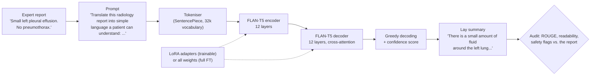
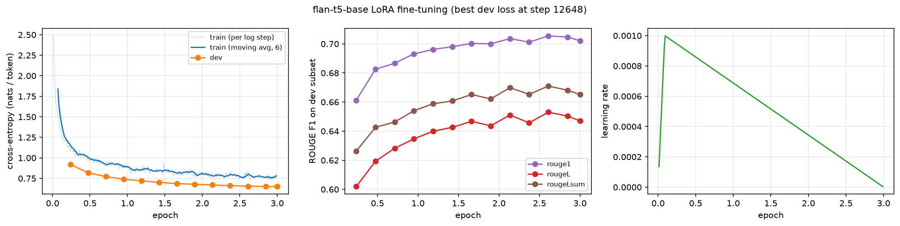
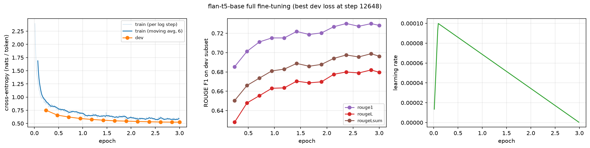
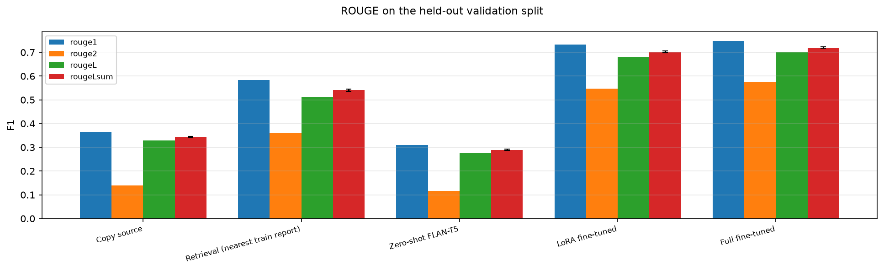
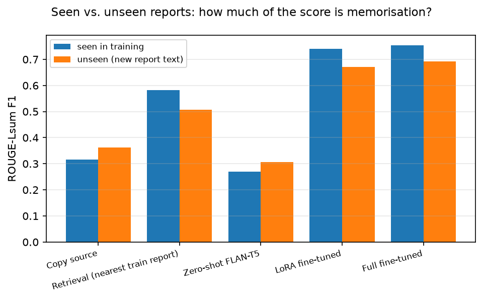
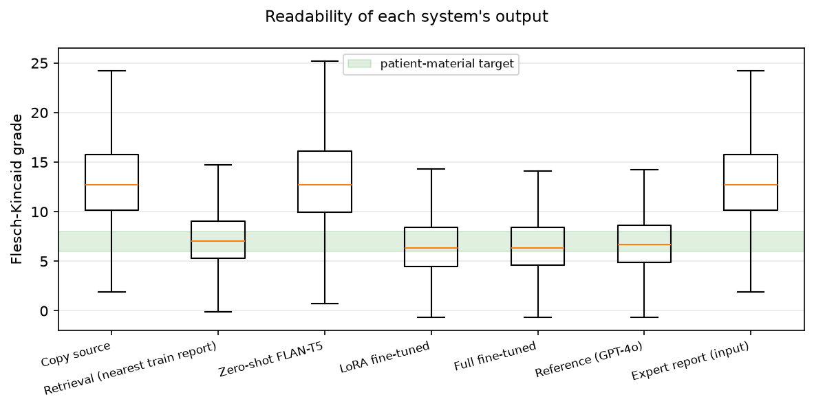
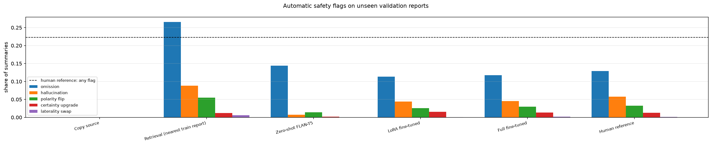
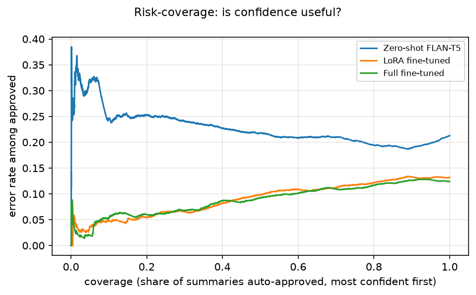

# Plain-Language Radiology Reports with FLAN-T5: LoRA vs. Full Fine-Tuning [Hard: T5 / FLAN-T5]

**COMP3710 Pattern Analysis 2026, Project 2.6 (Radiology Report Summarisation) · Aditya Raj Singh (48979519)**

Radiology reports are written for doctors ("Small left pleural effusion. No pneumothorax."), but
patients now read them in online portals and are often confused or frightened. This project
fine-tunes **FLAN-T5-base** [2], an instruction-tuned encoder-decoder Transformer [1, 3], to
rewrite chest X-ray reports as plain, patient-friendly text ("There is a small amount of fluid
around the left lung. There is no collapsed lung."), using the BioLaySumm 2025 LaymanRRG data
(~150k expert/lay report pairs) [8]. Two ways of adapting the 248M-parameter model are compared:
**full fine-tuning** (every weight is trained) and **LoRA** [4] (the model is frozen and two
small low-rank matrices are learned beside chosen layers: 1.77M trainable parameters, 0.71%).
Both are benchmarked against a **zero-shot** baseline (the same model, untrained), a
**copy-the-report** baseline and a **retrieval** baseline. Because a fluent summary can score well
on ROUGE while dropping or inventing a finding, every summary is also audited for clinical errors
(omitted, invented or negated findings, changed certainty, false reassurance), readability and
calibrated confidence, which answers the task's dilemma: *does fine-tuning preserve clinical
facts, or only improve surface fluency?*



<!-- TODO: paste ONE real example here as a small table (report -> zero-shot -> LoRA -> full ->
human reference), so readers see input and output at once. results/per_example_validation.csv
holds every system's summary of the same validation report. -->

---

## Contents
1. [Problem and algorithm](#1-problem-and-algorithm)
2. [Feasibility review](#2-feasibility-review-midpoint-check-off)
3. [Dependencies and reproducibility](#3-dependencies-and-reproducibility)
4. [Data, pre-processing and splits](#4-data-pre-processing-and-splits)
5. [Usage](#5-usage)
6. [Training curves and example outputs](#6-training-curves-and-example-outputs)
7. [Investigation of the open research dilemma](#7-investigation-of-the-open-research-dilemma)
8. [Artificial Intelligence Usage Disclosure](#artificial-intelligence-usage-disclosure)
9. [References](#9-references)

---

## 1. Problem and algorithm

### 1.1 The problem
The input is an expert chest X-ray report (PadChest, BIMCV-COVID19 or Open-i); the output is a
faithful layperson version of it (about grade 6-8 reading level). Errors are not equal: an
omitted pneumothorax, an invented mass, "no effusion" turned into "fluid around the lungs", or
"suspected pneumonia" turned into "pneumonia" can frighten or falsely reassure a patient. The
standard metric, ROUGE [6], only counts overlapping words, so it cannot see these errors.

### 1.2 Model: FLAN-T5
T5 [1] treats every task as text-to-text: an encoder reads the prompt + report, and a decoder
writes the output one token at a time, attending to the encoder through cross-attention.
FLAN-T5 [2] is T5 further trained on >1,800 instruction tasks, so it can follow a prompt
zero-shot. FLAN-T5-base has 12 encoder and 12 decoder layers (d_model = 768, 12 heads,
gated-GELU feed-forward, relative position biases) and 247.6M parameters. Every system uses the
same instruction: *"Translate this radiology report into simple language a patient can
understand: {report}"* (best of four wordings for the zero-shot model, Section 2).

### 1.3 LoRA (low-rank adaptation)
LoRA [4] freezes a pre-trained weight matrix $W_0 \in \mathbb{R}^{d_{out}\times d_{in}}$ and
learns a low-rank update beside it:

$$h = W_0x + \frac{\alpha}{r}\,BAx,\qquad A\in\mathbb{R}^{r\times d_{in}},\; B\in\mathbb{R}^{d_{out}\times r},\; r \ll d.$$

$B$ starts at zero, so training starts exactly from the pre-trained model; only $A$ and $B$ are
trained ($r(d_{in}+d_{out})$ numbers per layer instead of $d_{in}d_{out}$). Here LoRA is applied
to the query and value projections of every attention block (encoder self-attention, decoder
self- and cross-attention: 72 layers) with $r = 16$, $\alpha = 32$, dropout 0.05, giving
**1,769,472 trainable parameters (0.71%)**. After training, $\frac{\alpha}{r}BA$ can be added
into $W_0$ (`predict.py --export-merged`), so the deployed model is a plain FLAN-T5 with no
extra inference cost, and the adapter checkpoint is only ~7 MB. `LoRALinear`, `inject_lora` and
`merge_lora` in `modules.py` implement this directly in PyTorch (no PEFT library).

### 1.4 Training objective and decoding
Both modes minimise the token-level cross-entropy of the reference lay summary $y$ given the
prompted report $x$, with teacher forcing:

$$\mathcal{L}(\theta) = -\frac{1}{|y|}\sum_{t=1}^{|y|}\log p_\theta(y_t \mid y_{<t}, x).$$

Optimiser AdamW (weight decay 0.01, none on layer norms), linear warm-up over 3% of the steps
then linear decay; learning rate 1e-3 (LoRA) / 1e-4 (full) <!-- TODO: update if you changed it -->;
bfloat16 autocast on the A100 (T5 is unstable in fp16 but stable in bf16); gradient clipping at
1.0; batches of similar-length examples (at most 32 examples and 5,120 padded tokens, which
bounds GPU memory). Every 1,000 steps the model is evaluated on the dev split (loss and ROUGE);
the checkpoint with the lowest dev loss is kept and training stops after 4 evaluations without
improvement. Summaries are generated greedily (at most 320 new tokens). The **confidence** of a
summary is its mean token log-probability under the model, computed by re-scoring the generated
tokens with teacher forcing (verified in `tests/` to equal the decoder's own probabilities).

### 1.5 Baselines
| Baseline | What it is | Why it is useful |
|---|---|---|
| Zero-shot FLAN-T5 | the same model and prompt, no training | the task's required baseline: what does fine-tuning add? |
| Copy source | output the expert report unchanged | shows how much ROUGE rewards copying words that are not lay language |
| Retrieval | the human lay summary of the most similar *training* report (TF-IDF cosine) | fluent, human-written, often high ROUGE, but about another patient, so it shows ROUGE's blindness to facts |

---

## 2. Feasibility review (midpoint check-off)


**1. User need, scope and acceptance criteria.** User: a hospital patient-portal team that
wants draft plain-language versions of chest X-ray reports, *reviewed before release* when
uncertain. Prototype scope: English chest X-ray reports (PadChest, BIMCV-COVID19, Open-i); no
images; research prototype, not a medical device.

| # | Acceptance criterion (official validation split, never used for training) | Target |
|---|---|---|
| AC1 | Summary quality: ROUGE-Lsum of the fine-tuned model vs. zero-shot baseline, on all reports and on reports whose text never occurs in training | > zero-shot on both, ROUGE-1 ≥ 0.6 overall |
| AC2 | Readability: median Flesch-Kincaid grade of the summaries | ≤ 8 |
| AC3 | Clinical safety: share of summaries with an automatic safety flag on unseen reports, relative to the human references (checker false-alarm floor) | ≤ 1.5 × the human-reference rate; false reassurance ≤ 0.5% |
| AC4 | Guardrail: a confidence/entity rule that auto-approves ≥ 80% of summaries | residual error among approved ≤ half the unfiltered error |
| AC5 | Operational: peak training VRAM; time to summarise one report on one A100 | ≤ 40 GB; ≤ 1 s |

**2. Model choice and course concepts.** FLAN-T5-base [2] (encoder-decoder Transformer [3]),
adapted with LoRA [4] and with full fine-tuning; the task lists T5/FLAN-T5 as Hard. Course
concepts: attention and Transformers, transfer learning from pre-trained models, maximum
likelihood / cross-entropy, regularisation and early stopping on a validation set, evaluation
beyond accuracy (calibration, precision/recall of safety rules).

**3. Preliminary evidence.** <!-- TODO: paste from results/feasibility.md: the data audit table
(rows, sources, lengths), the duplicate statistics (45% of validation reports also occur in
training), token lengths and truncation, the prompt-selection table (zero-shot ROUGE, copy and
empty rates; copying the report beats the zero-shot model), and the smoke tests (loss falling,
ms/step, peak VRAM, projected minutes per epoch for LoRA and full). -->

**4. Risks, budget and fallback.**
- Over-optimistic scores from duplicated reports → report-grouped dev split; validation results split into seen vs. unseen reports.
- ROUGE hides clinical errors → rule-based safety audit (calibrated on human references) and a manual audit of 3-5 failures.
- GPU memory spikes on long reports → token-budget batching; bf16.
- Rangpur compute nodes offline → data and weights pre-downloaded (`download.py`), jobs run with `HF_HUB_OFFLINE=1`.
- Budget: <!-- TODO: e.g. ~X A100 GPU-hours from the smoke-test projection -->.
- Fallback: if full fine-tuning does not fit or is too slow, LoRA alone (the comparison then uses LoRA ranks); if time runs short, train for fewer epochs (checkpoints are kept at every improvement).
- Next experiment after the check-off: <!-- TODO -->

---

## 3. Dependencies and reproducibility
<!-- TODO: replace with the exact versions printed on Rangpur (they are also stored in
runs/*/summary.json under "versions" and at the top of results/feasibility.md). -->

| Package | Version | Used for |
|---|---|---|
| Python | <!-- TODO --> | |
| PyTorch (CUDA) | <!-- TODO --> | training and inference (`modules.py` uses PyTorch + transformers, no NumPy) |
| transformers / tokenizers | <!-- TODO --> | the pre-trained FLAN-T5 backbone and tokenizer |
| huggingface_hub | <!-- TODO --> | downloading pinned data and model revisions |
| pandas, pyarrow | <!-- TODO --> | reading the parquet data files |
| rouge-score | <!-- TODO --> | ROUGE-1/2/L/Lsum (same implementation as the BioLaySumm organisers) |
| scikit-learn | <!-- TODO --> | TF-IDF for the retrieval baseline only |
| matplotlib, numpy | <!-- TODO --> | figures, statistics |
| pytest | <!-- TODO --> | unit tests |

Hardware: one NVIDIA A100 on Rangpur <!-- TODO: exact model / memory from the "gpu" entry in
runs/lora/summary.json -->. Reproducibility: the dataset (commit `6783ab38`) and model
revisions are pinned in `config.py`; all seeds are fixed (42 for training and splits, 0 for
sampling); every run stores its arguments and library versions in `summary.json`. bfloat16 and
cuDNN kernels make GPU results reproducible to small numerical noise rather than bit-exactly.
Model weights are not committed (task rules); `scripts/run_all.sh` retrains them.

---

## 4. Data, pre-processing and splits
**Data.** BioLaySumm 2025 Subtask 2.1, LaymanRRG open-source track [8] (Hugging Face
`BioLaySumm/BioLaySumm2025-LaymanRRG-opensource-track`): pairs of an expert chest X-ray report
and a lay rewrite. Columns: `source`, `images_path` (unused: text only), `radiology_report`,
`layman_report`. Official splits: train 150,454, validation 10,000, test 10,537 (the test lay
references are not public).

<!-- TODO: paste the audit table from results/feasibility.md (rows per source, word lengths). -->

**Pre-processing** (`dataset.py`): whitespace normalised; the prompt is added; inputs are
truncated to 384 tokens and targets to 320 tokens (the final `</s>` is kept), which truncates
about 0.5% of reports and 0.75% of summaries. No other text cleaning, because the reports'
wording (including hedges and negations) is exactly what must be preserved.

**Splits and leakage.** The data has no patient ids, so *identical report text* is treated as the
unit of leakage (the text analogue of patient-level splitting):
1. Exact duplicate (report, lay) pairs are removed from training (150,454 → 116,598 rows); the
   same report with different lay versions is kept (legitimate variation).
2. A **dev split** of ~1,000 rows is held out of training *by report text*: whole groups of
   identical reports go to dev, so no report string is in both (checked by an assertion).
   Very common boiler-plate reports (> 50 copies, e.g. "No significant findings.") stay in
   training. Dev is used for early stopping and model selection only.
3. The **official validation split** is the held-out benchmark, used once at the end (the task
   evaluates on it because test references are hidden). Audit: **45% of its reports also occur
   verbatim in training** (mostly normal reports), so every result is also reported on the
   **unseen** subset (new report text), which is the honest generalisation estimate.
4. The **official test split** (no references; 99.6% unseen report text) is used for the
   reference-free clinical-safety audit on genuinely new reports.

<!-- TODO: 1-2 sentences on the limitations: no patient ids (two different reports of one patient
could still be split across train and validation), and a dev split drawn from the training
distribution. -->

---

## 5. Usage
All commands run from this folder on Rangpur. Never train on the login node.

```bash
# one-off setup on the LOGIN node (internet access): packages, data and model weights
source $HOME/miniconda3/bin/activate && conda activate torch
pip install --no-cache-dir "transformers>=4.44,<5" sentencepiece rouge-score pandas pyarrow scikit-learn pytest
OMP_NUM_THREADS=1 python download.py          # ~30 MB data + ~1 GB FLAN-T5-base, pinned revisions
python -m pytest -q tests                     # unit tests (tiny random T5, no GPU needed)

# the whole pipeline as dependent Slurm jobs
bash scripts/run_all.sh        # feasibility -> LoRA & full fine-tuning -> predict + evaluate
squeue --me                    # watch; logs are in logs/

# or step by step (logs/ must exist first, or Slurm cannot write the job output)
mkdir -p logs
sbatch scripts/feasibility.slurm      # -> results/feasibility.md
sbatch scripts/train_lora.slurm       # -> runs/lora/{best.pt,steps.csv,evals.csv,curves.png,summary.json}
sbatch scripts/train_full.slurm       # -> runs/full/...
sbatch scripts/evaluate.slurm         # -> predictions/, results/, figures/
bash scripts/run_ablation.sh          # optional: LoRA rank 4/64, LoRA on all layers, FLAN-T5-small
```

**Example usage of the trained model (`predict.py`).**
```bash
python predict.py --checkpoint runs/lora/best.pt --n 5          # 5 held-out validation reports
python predict.py --checkpoint runs/full/best.pt \
    --text "Small left pleural effusion. No pneumothorax. Possible right basal consolidation."
python predict.py --zeroshot --n 5                               # the untrained baseline
python predict.py --checkpoint runs/lora/best.pt --export-merged exported/flan_t5_lay   # deployable model
```
Input: one or more report texts. Output (printed and saved to `predictions/`): the lay summary,
its confidence, the automatic safety flags against the report, the reading grade and (for
validation reports) ROUGE against the human reference.

**Tests.** `python -m pytest -q tests` (29 tests, ~15 s on a CPU) checks, among others, that LoRA
starts exactly at the pre-trained model and merges exactly, that only adapters train, that
padding never counts in the loss, that dev and train share no report text, that the confidence
score equals the decoder's own probabilities, and 14 hand-written safety cases (negation,
hedging, lay wording, left-right swaps, "no change in X" is not a negation).

| File | Contents |
|---|---|
| `modules.py` | `LoRALinear`, `inject_lora`, `merge_lora`, `LaySummariser` (FLAN-T5 + generation + confidence) |
| `dataset.py` | reading, de-duplication, report-grouped dev split, seen/unseen marking, tokenisation, token-budget batching, audit |
| `train.py` | training / validation / early stopping / checkpoints for `--mode lora` and `--mode full` (torchrun-ready); loss curves |
| `predict.py` | driver: loads a checkpoint, summarises reports, prints flags/confidence/ROUGE, exports a merged model |
| `evaluate.py` | the investigation: baselines, ROUGE (CI, seen/unseen), readability, safety audit, guardrails, resources, autopsy |
| `safety.py` | rule-based clinical-safety checker (findings, negation, hedging, false reassurance) and readability |
| `feasibility.py` | data audit, prompt selection and smoke tests for the feasibility review |
| `config.py`, `download.py`, `utils.py` | pinned constants; data/weight download (login node); ROUGE, statistics, plots |
| `scripts/`, `tests/` | Slurm jobs for Rangpur; unit tests |

---

## 6. Training curves and example outputs


<!-- TODO: for each plot, 1-2 sentences: how fast the training loss fell, where the dev loss
stopped improving (best step / epoch), whether dev ROUGE kept rising after the dev loss
flattened, and how LoRA and full fine-tuning differ in speed of learning. -->

<!-- TODO: 2-3 example outputs (report, human reference, LoRA, full) from
results/per_example_validation.csv or predictions/examples.md, including one where the model does
well and one where it does not. -->

---

## 7. Investigation of the open research dilemma
*The high-ROUGE vs. clinical-safety dilemma: does fine-tuning FLAN-T5 (LoRA or full) preserve the
clinical facts of a report, or does it mainly learn the lay writers' style?* All numbers are on
the same held-out reports and come from `results/summary.md` (per-report details in
`results/per_example_validation.csv`).

### 7.1 Benchmark against the baselines (ROUGE)
<!-- TODO: paste table 1 of results/summary.md (ROUGE-1/2/L/Lsum with CI; seen vs unseen) and the
paired-bootstrap table; include figures/rouge_systems.png. -->


<!-- TODO (analysis, your words): How much do LoRA and full fine-tuning gain over zero-shot? Is the
LoRA-full difference significant (CI excludes 0?) and is it practically meaningful? Where does the
copy-source baseline land, and what does that say about ROUGE (it rewards the expert words a
patient cannot understand)? How close does the retrieval baseline get, and why is that alarming? -->

### 7.2 Memorisation: seen vs. unseen reports

<!-- TODO: How much higher is ROUGE on reports whose text occurs in training? Which system profits
most from duplicates (retrieval should)? What is the honest generalisation score (unseen)?
Does the gap differ between LoRA and full fine-tuning? Also look at figures/rouge_by_length.png:
where do summaries degrade? -->

### 7.3 Readability

<!-- TODO: paste table 2. Compare grade levels and jargon of the expert input, the human
references, zero-shot (near-copies?), LoRA and full. Does AC2 hold? -->

### 7.4 Clinical-safety audit
The rule-based checker (`safety.py`) finds the critical findings (pneumothorax, pleural effusion,
lung opacity / infection, cardiomegaly, nodule / mass, fracture, pulmonary oedema) in both
texts, in expert and in lay wording ("pneumothorax" = "collapsed lung", "effusion" = "fluid
around the lungs"), decides for each mention whether it is negated ("no", "there are no",
"we didn't see", "has resolved"; but "no change in the effusion" is not a negation), whether
it is hedged ("possible", "suggests", "may", "cannot be excluded") and which side it is on
(left / right / both), and compares the summary with the source report: omission,
hallucination, polarity flip, certainty upgrade / downgrade, left-right swap and false
reassurance. **Calibration:** on the human references the checker fires on 16% of the validation
summaries (22% of those for unseen reports); that is its noise floor (lay writers paraphrase in
ways the rules miss, and some references really do omit or garble findings), so models are judged
relative to the human row. The left-right check is much stricter (it fires on ~0.1% of human
references). Not covered:
wrong imaging modality, dates, sizes and non-critical findings (see 7.7).

<!-- TODO: paste table 3 and figures/safety_flags.png. Then, in your words: compared with the human
references, do the fine-tuned models omit, invent or flip findings more or less often? Which flag
type dominates? Does zero-shot look "safe" only because it copies the report? Report the
false-reassurance rate. IMPORTANT: open 20 flagged LoRA summaries in
results/per_example_validation.csv and count how many are genuine errors; quote that precision
(e.g. "15/20 flags were real errors"). That manual check is your evidence that the metric
means something. -->


### 7.5 Confidence and guardrails

<!-- TODO: paste table 4. Is low confidence associated with errors (AUROC well above 0.5) or is the
model "stubbornly confident" when wrong? Which guardrail policy meets AC4: how many summaries can
be auto-approved and what residual error remains? -->

### 7.6 Resource profile: LoRA vs. full fine-tuning
<!-- TODO: paste table 5 (parameters, trainable, train time, peak training VRAM, checkpoint size,
latency). Check AC5. Discuss the trade-off: LoRA trains 0.7% of the weights, uses less memory and
stores a ~7 MB adapter (one base model can serve several adapters), but does it lose quality? Full
fine-tuning: 1 GB checkpoints, more VRAM; is the gain (if any) worth it? If you ran
run_ablation.sh, add the rank / all-layers / small-model results here. -->

### 7.7 Failure-case autopsy
<!-- TODO: read results/autopsy_candidates.md and write 3-5 cases. For each: the report, the summary,
what is wrong, the likely trigger, and the clinical consequence for the patient. Only describe
what YOU see. Typical triggers to look for:
| Case | What is wrong | Likely trigger | Consequence |
| long multi-finding report | a finding dropped | truncation / long inputs are rare in training | missed follow-up |
| negated list ("no pneumothorax or effusion") | negation lost | lay rewrite turns the list positive | false alarm |
| hedged finding ("suggestive of pneumonia") | stated as certain | lay style prefers definite statements | false diagnosis |
| rare term (e.g. "Kerley B lines") | vague or wrong lay term | rare in training | misunderstanding |
| report about a follow-up ("improvement of ...") | change described as new | temporal language | anxiety |
-->

### 7.8 Recommendation to the project manager
<!-- TODO: an evidence-based verdict in your words, e.g.:
- Quality: AC1 met or not (numbers, seen vs unseen).
- Safety: AC3; which errors remain; the false-reassurance rate.
- Deployment rule: which guardrail (AC4): e.g. auto-release only confident summaries with no
  entity-check flag; route the rest to a clinician; never release without the original report.
- LoRA vs. full: which to deploy and why (cost, memory, adapters per hospital vs. quality).
- Where it must NOT be used (e.g. reports with critical findings such as pneumothorax should always
  be reviewed; non-chest studies; languages other than English).
- Next steps: entity-aware training or constrained decoding, a medical-term glossary, human
  evaluation with patients, larger models (FLAN-T5-large with LoRA). -->

---

## Artificial Intelligence Usage Disclosure
<!-- Section 8. The heading text must stay exactly as above (required by the task sheet).
TODO: make this accurate for YOU. Keep what is true, delete what is not, add specifics. -->

**Tools used.** Claude (Anthropic), via claude.ai.

**What it was used for.**
- Reviewing the task sheet and previous years' pull requests to choose the project and understand
  common review feedback (training curves with enough points, comments, data leakage, deployable
  LoRA models, metrics in the expected range).
- Generating the initial implementation of `modules.py`, `dataset.py`, `train.py`, `predict.py`,
  `evaluate.py`, `safety.py`, `feasibility.py`, `download.py`, `config.py`, `utils.py`, the unit
  tests, the Slurm scripts, and a first draft of the method sections of this README.
- Explaining the underlying concepts (T5 and FLAN instruction tuning, LoRA, teacher forcing,
  ROUGE, Flesch-Kincaid, NegEx-style negation detection, calibration and selective prediction).

**How the output was audited and verified.**
- Unit tests (`tests/`): LoRA output equals the frozen layer at initialisation and merging is exact;
  only adapter weights train; padding is masked from the loss; the dev split shares no report text
  with training; the confidence score equals the greedy decoder's log-probabilities; ROUGE, AUROC and
  readability behave as expected; 14 hand-written clinical cases for the safety rules. The tests pass
  with transformers 4.57 and 5.21.
- The safety checker's false-alarm rate was measured on human-written references before being used
  on model outputs.
- <!-- TODO: what you checked on Rangpur, e.g. the audit numbers (45% overlap) by hand on a few
  reports, a manual review of N flagged summaries, that predict.py reproduces evaluate.py's outputs,
  GPU memory against the smoke test. -->
- <!-- TODO: anything you changed or fixed yourself, and why (learning rate, epochs, prompt choice,
  bugs you found, settings you chose after looking at results). -->
- All analysis and conclusions in Sections 7.1-7.8 are my own, based on my Rangpur runs.

---

## 9. References
1. C. Raffel et al. *Exploring the Limits of Transfer Learning with a Unified Text-to-Text Transformer.* JMLR 21(140), 2020.
2. H. W. Chung et al. *Scaling Instruction-Finetuned Language Models.* arXiv:2210.11416, 2022.
3. A. Vaswani et al. *Attention Is All You Need.* NeurIPS 2017.
4. E. J. Hu et al. *LoRA: Low-Rank Adaptation of Large Language Models.* ICLR 2022.
5. I. Loshchilov, F. Hutter. *Decoupled Weight Decay Regularization (AdamW).* ICLR 2019.
6. C.-Y. Lin. *ROUGE: A Package for Automatic Evaluation of Summaries.* ACL Workshop, 2004.
7. W. W. Chapman et al. *A Simple Algorithm for Identifying Negated Findings and Diseases in Discharge Summaries (NegEx).* J. Biomedical Informatics 34(5), 2001.
8. C. Xiao et al. *Overview of the BioLaySumm 2025 Shared Task on Lay Summarization of Biomedical Research Articles and Radiology Reports.* BioNLP Workshop @ ACL 2025. Data: https://huggingface.co/datasets/BioLaySumm/BioLaySumm2025-LaymanRRG-opensource-track
9. J. P. Kincaid et al. *Derivation of New Readability Formulas for Navy Enlisted Personnel.* Research Branch Report 8-75, 1975.
10. Y. Geifman, R. El-Yaniv. *Selective Classification for Deep Neural Networks.* NeurIPS 2017 (risk-coverage curves).
11. B. Efron, R. Tibshirani. *An Introduction to the Bootstrap.* Chapman & Hall, 1993.
12. A. Bustos et al. *PadChest: A large chest x-ray image dataset with multi-label annotated reports.* Medical Image Analysis 66, 2020.
13. COMP3710 Report specification v2.5 (task sheet).
