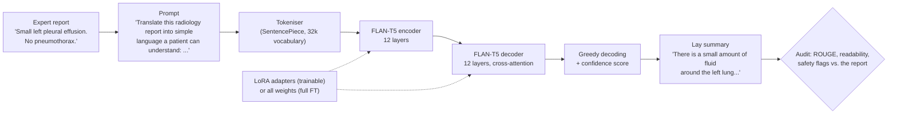

# Plain-Language Radiology Reports with FLAN-T5: LoRA vs. Full Fine-Tuning [Hard: T5 / FLAN-T5]

**COMP3710 Pattern Analysis 2026, Project 2.6 (Radiology Report Summarisation) · Aditya Raj Singh (48979519)**

Radiology reports are written for doctors ("Small left pleural effusion. No pneumothorax."), but
patients now read them in online portals and are often confused or frightened. This project
fine-tunes **FLAN-T5-base** [2], an instruction-tuned encoder-decoder Transformer [1, 3], to
rewrite chest X-ray reports as plain, patient-friendly text ("There is a small amount of fluid
around the left lung. There is no collapsed lung."), using the BioLaySumm 2025 LaymanRRG data
(~150k pairs of an expert report and a lay version written by GPT-4o) [8, 15]. Two ways of adapting the 248M-parameter model are compared:
**full fine-tuning** (every weight is trained) and **LoRA** [4] (the model is frozen and two
small low-rank matrices are learned beside chosen layers: 1.77M trainable parameters, 0.71%).
Both are benchmarked against a **zero-shot** baseline (the same model, untrained), a
**copy-the-report** baseline and a **retrieval** baseline. Because a fluent summary can score well
on ROUGE while dropping or inventing a finding, every summary is also audited for clinical errors
(omitted, invented or negated findings, changed certainty, false reassurance), readability and
calibrated confidence, which answers the task's dilemma: *does fine-tuning preserve clinical
facts, or only improve surface fluency?*



**One held-out example** (validation-5671; its text never occurs in the training data):

| | Summary | ROUGE-Lsum | Safety flags |
|---|---|---|---|
| **Expert report (input)** | Cardiomegaly. Laminar atelectasis in the left base. No areas of consolidation, ground-glass opacities, or pleural effusion are observed. | | |
| Zero-shot FLAN-T5 | The left base is a pleural effusion. | 0.143 | omission (enlarged heart), polarity flip (invents the effusion the report rules out) |
| LoRA fine-tuned | The heart is enlarged. There is a thin layer of collapsed lung at the bottom left part of the lung. No areas of lung thickening, hazy areas, or fluid around the lungs are seen. | 0.899 | none |
| Full fine-tuned | The heart is enlarged. There is a thin layer of collapsed lung at the bottom left. No areas of lung thickening, hazy lung opacities, or fluid around the lungs are seen. | 0.939 | none |
| Reference (GPT-4o) | The heart is enlarged. There is a thin layer of collapsed lung at the bottom of the left lung. No areas of solid lung thickening, hazy lung opacities, or fluid around the lungs are seen. | | |

**Results at a glance** (official validation split: 10,000 reports, 5,505 of them unseen in training):

| | Zero-shot | LoRA | Full fine-tuning | Reference (GPT-4o) |
|---|---|---|---|---|
| ROUGE-1 / ROUGE-Lsum | 0.309 / 0.289 | 0.732 / 0.702 | **0.749 / 0.720** | |
| ROUGE-Lsum on unseen reports | 0.306 | 0.671 | **0.692** | |
| Median reading grade (target ≤ 8) | 12.7 | **6.3** | 6.4 | 6.7 |
| Summaries with a safety flag (unseen) | 15.9% \* | **19.2%** | 20.1% | 22.3% (the checker's floor) |
| Disagrees with the reference summary on a critical finding | 21.3% | 13.2% | **12.4%** | |
| Trainable parameters / checkpoint size | 0 | 1.77M (0.71%) / **6.8 MB** | 247.6M / 1.1 GB | |
| Peak training VRAM / training time (one A100) | | **13.6 GB / 36 min** | 17.3 GB / 41 min | |

\* low only because 64.7% of the zero-shot outputs are near-copies of the expert report; when
it does rewrite, 36.8% of its summaries are flagged.

**In short:** fine-tuning gives patient-level language and keeps the critical findings about as
reliably as the reference summaries, but it also learns their mistakes (GPT-4o wrote them) and
makes rare, confident slips that ROUGE cannot see (an invented enlarged heart scores ROUGE-Lsum 0.94). Recommendation:
LoRA, in a clinician-supervised pilot with entity-check guardrails, not automatic release
([Section 7.8](#78-recommendation-to-the-project-manager)).

---

## Contents
1. [Problem and algorithm](#1-problem-and-algorithm)
2. [Feasibility review](#2-feasibility-review-midpoint-check-off)
3. [Dependencies and reproducibility](#3-dependencies-and-reproducibility)
4. [Data, pre-processing and splits](#4-data-pre-processing-and-splits)
5. [Usage](#5-usage)
6. [Training curves and example outputs](#6-training-curves-and-example-outputs)
7. [Investigation of the open research dilemma](#7-investigation-of-the-open-research-dilemma):
   [7.1 ROUGE benchmark](#71-benchmark-against-the-baselines-rouge) ·
   [7.2 Seen vs. unseen](#72-memorisation-seen-vs-unseen-reports) ·
   [7.3 Readability](#73-readability) ·
   [7.4 Safety audit](#74-clinical-safety-audit) ·
   [7.5 Guardrails](#75-confidence-and-guardrails) ·
   [7.6 Resources](#76-resource-profile-lora-vs-full-fine-tuning) ·
   [7.7 Failure autopsy](#77-failure-case-autopsy) ·
   [7.8 Recommendation](#78-recommendation-to-the-project-manager)
8. [Limitations](#8-limitations)
9. [References](#9-references)

---

## 1. Problem and algorithm

### 1.1 The problem
The input is an expert chest X-ray report (PadChest, BIMCV-COVID19 or Open-i); the output is a
faithful layperson version of it (about grade 6-8 reading level). Errors are not equal: an
omitted pneumothorax, an invented mass, "no effusion" turned into "fluid around the lungs", or
"suspected pneumonia" turned into "pneumonia" can frighten or falsely reassure a patient. The
standard metric, ROUGE [6], only counts overlapping words, so it cannot see these errors.

### 1.2 Model: FLAN-T5
T5 [1] treats every task as text-to-text: an encoder reads the prompt + report, and a decoder
writes the output one token at a time, attending to the encoder through cross-attention.
FLAN-T5 [2] is T5 further trained on >1,800 instruction tasks, so it can follow a prompt
zero-shot. FLAN-T5-base has 12 encoder and 12 decoder layers (d_model = 768, 12 heads,
gated-GELU feed-forward, relative position biases) and 247.6M parameters. Every system uses the
same instruction: *"Translate this radiology report into simple language a patient can
understand: {report}"* (best of four wordings for the zero-shot model, Section 2).

### 1.3 LoRA (low-rank adaptation)
LoRA [4] freezes a pre-trained weight matrix $W_0 \in \mathbb{R}^{d_{out}\times d_{in}}$ and
learns a low-rank update beside it:

$$h = W_0x + \frac{\alpha}{r}\,BAx,\qquad A\in\mathbb{R}^{r\times d_{in}},\; B\in\mathbb{R}^{d_{out}\times r},\; r \ll d.$$

$B$ starts at zero, so training starts exactly from the pre-trained model; only $A$ and $B$ are
trained ($r(d_{in}+d_{out})$ numbers per layer instead of $d_{in}d_{out}$). Here LoRA is applied
to the query and value projections of every attention block (encoder self-attention, decoder
self- and cross-attention: 72 layers) with $r = 16$, $\alpha = 32$, dropout 0.05, giving
**1,769,472 trainable parameters (0.71%)**. After training, $\frac{\alpha}{r}BA$ can be added
into $W_0$ (`predict.py --export-merged`), so the deployed model is a plain FLAN-T5 with no
extra inference cost, and the adapter checkpoint is only ~7 MB. `LoRALinear`, `inject_lora` and
`merge_lora` in `modules.py` implement this directly in PyTorch (no PEFT library).

### 1.4 Training objective and decoding
Both modes minimise the token-level cross-entropy of the reference lay summary $y$ given the
prompted report $x$, with teacher forcing:

$$\mathcal{L}(\theta) = -\frac{1}{|y|}\sum_{t=1}^{|y|}\log p_\theta(y_t \mid y_{<t}, x).$$

Optimiser AdamW (weight decay 0.01, none on layer norms), linear warm-up over 3% of the steps
then linear decay to zero; learning rate 1e-3 for LoRA (the adapters start at zero and need
bigger steps) and 1e-4 for full fine-tuning; bfloat16 autocast on the A100 (T5 is unstable in
fp16 but stable in bf16); gradient clipping at 1.0; batches of similar-length examples (at most
32 examples and 5,120 padded tokens, which bounds GPU memory). Both modes ran for 3 epochs
(12,648 optimiser steps). Every 1,000 steps the model is evaluated on the dev split (loss and
ROUGE); the checkpoint with the lowest dev loss is kept and training stops after 4 evaluations
without improvement. At the end, `train.py` reloads the best checkpoint and tests it on held-out
validation reports. Summaries are generated greedily (at most 320 new tokens). The **confidence** of a
summary is its mean token log-probability under the model, computed by re-scoring the generated
tokens with teacher forcing (verified in `tests/` to equal the decoder's own probabilities).

### 1.5 Baselines
| Baseline | What it is | Why it is useful |
|---|---|---|
| Zero-shot FLAN-T5 | the same model and prompt, no training | the task's required baseline: what does fine-tuning add? |
| Copy source | output the expert report unchanged | shows how much ROUGE rewards copying words that are not lay language |
| Retrieval | the reference lay summary of the most similar *training* report (TF-IDF cosine) | fluent, well written, often high ROUGE, but about another patient, so it shows ROUGE's blindness to facts |

### 1.6 Related work and published results
- **The task and its labels.** BioLaySumm 2025 Subtask 2.1 [8] built its radiology track on the
  LaymanRRG framework [15], in which GPT-4o translates each expert report into lay language. The
  references are therefore *silver* labels: fluent and mostly right, but written by a model, not
  by clinicians or patients. This matters for every comparison against them (Sections 7.4, 7.7).
- **A published result for orientation.** The AEHRC team fine-tuned T5-large (770M parameters,
  about three times FLAN-T5-base) and reached ROUGE-L 66.9 with a Flesch-Kincaid grade of 7.4 on
  the open-track test set, scored by the organisers [16]. The numbers here come from the
  validation split (test references are hidden) with a 248M model, so the two are not directly
  comparable, but they are in the same range (ROUGE-L 0.70 here; 0.69 ROUGE-Lsum on unseen reports).
- **ROUGE and factual errors.** Zhang et al. [17] showed that summaries of radiology reports can
  score well on ROUGE and still contain factual errors, and added a factual-correctness reward
  built on the clinical findings extracted from each summary. This project measures the same gap
  with a transparent rule-based checker (Section 7.4) and then asks whether that checker can work
  as a deployment guardrail (Section 7.5).

---

## 2. Feasibility review (midpoint check-off)
This is the one-page review written for the midpoint check-off, before the full training runs.
The evidence in part 3 comes from `results/feasibility.md` (Rangpur, one A100). How the
finished prototype did against each acceptance criterion is in [Section 7.8](#78-recommendation-to-the-project-manager).

*Correction since the check-off:* the review calls the reference summaries "human"; they were
written by GPT-4o (Section 4). Nothing else changes: the checker's floor is still measured on the
same references.

**1. User need, scope and acceptance criteria.** A hospital patient-portal team wants draft
plain-language versions of chest X-ray reports, released automatically only when safe and
otherwise reviewed by a clinician. Scope: English chest X-ray reports (BioLaySumm 2025
LaymanRRG: PadChest, BIMCV-COVID19, Open-i), text only; a research prototype, not a medical
device. The dilemma is high ROUGE vs. clinical safety, so the criteria cover both:

| # | Acceptance criterion (official validation split, never trained on) | Target |
|---|---|---|
| AC1 | Summary quality: ROUGE-Lsum vs. the zero-shot baseline, on all reports and on reports whose text never occurs in training | above zero-shot on both; ROUGE-1 ≥ 0.6 |
| AC2 | Readability: median Flesch-Kincaid grade of the summaries | ≤ 8 |
| AC3 | Clinical safety: share of summaries with an automatic safety flag on unseen reports, relative to the human references (the checker's false-alarm floor); false reassurance | ≤ 1.5 × the human rate; ≤ 0.5% |
| AC4 | Guardrail: a confidence / entity rule that auto-approves ≥ 80% of summaries | residual error ≤ half the unfiltered error |
| AC5 | Operational: peak training VRAM; time to summarise one report on one A100 | ≤ 40 GB; ≤ 1 s |

**2. Model choice and course concepts.** FLAN-T5-base (248M parameters) [2], an
instruction-tuned encoder-decoder Transformer [1, 3], adapted two ways: LoRA [4] (rank 16 on the
q/v attention projections, 1.77M trainable = 0.71%) and full fine-tuning. The task lists T5 /
FLAN-T5 as Hard. Baselines: zero-shot FLAN-T5, copy-the-report, nearest-training-report
retrieval. Course concepts: attention and Transformers, transfer learning from pre-trained
models, cross-entropy / maximum likelihood, validation-based early stopping, evaluation beyond
accuracy (calibration, error analysis).

**3. Preliminary evidence.**
- *Data audit:* train 150,454 rows → 116,598 after removing duplicate (report, lay) pairs;
  validation 10,000; test 10,537 (no lay references). Sources: PadChest 78%, BIMCV-COVID19 21%,
  Open-i 1.5%. **45% of validation reports occur verbatim in training**, so results are split
  into seen and unseen reports and the dev split is grouped by report text. Tokens (median / p99):
  prompt + report 46 / 282, summary 41 / 287; the 384 / 320 limits truncate 0.5% / 0.75%.
- *Prompt selection* (zero-shot FLAN-T5-base, A100, 128 dev reports): the best of four wordings
  is "translate" (ROUGE-1 0.299, ROUGE-Lsum 0.275), but it returns the report unchanged 33% of
  the time; **copying the report scores higher** (0.341 / 0.317). ROUGE rewards expert words, so
  safety and readability audits are needed.
- *Smoke tests* (A100-40GB, FLAN-T5-base, 40 steps, batch 32, bf16): the loss falls in both
  modes. LoRA 2.45 → 1.80, 151 ms/step, 12.8 GB peak; full 2.29 → 1.58, 139 ms/step, 16.4 GB,
  so about 9 min per epoch each. LoRA saves memory (−22%) and storage, not time: gradients still
  pass through the frozen model.
- *Unit tests:* 29 pass (LoRA starts at / merges back to the base model, padding is masked, no
  report text is shared between train and dev). Testing found a real checker bug ("not
  visualized" read as a positive finding), fixed with a regression test (30 pass).

**4. Risks, budget and fallback.**
- Memorised duplicates inflate ROUGE → de-duplication, text-grouped dev split, seen/unseen reporting.
- ROUGE hides clinical errors → a rule-based safety audit calibrated on the human references (it
  flags 16% of them, 22% on unseen reports: the floor), a manual check of 20 flags, and 3-5
  autopsy cases.
- GPU memory spikes on long reports → token-budget batching, bf16. Offline compute nodes →
  everything pre-downloaded, jobs run with `HF_HUB_OFFLINE=1`.
- Budget: about 2-3 A100 GPU-hours (2 × ~40 min training for 3 epochs, ~30 min evaluation,
  ~15 min feasibility), plus ablations if time allows; both modes fit one 40 GB A100 easily.
- Next experiment: full runs of both modes, then the evaluation; then LoRA rank / layer ablations.
- Fallback: if full fine-tuning is too slow or too large, LoRA only (compare ranks instead);
  fewer epochs (the best checkpoint is kept at every improvement).

---

## 3. Dependencies and reproducibility
Exact versions of the Rangpur environment that produced every result in this README (the
`torch` conda env plus the pip line in Section 5), as printed by
`python -c "import utils; print(utils.library_versions())"` on Rangpur.

| Package | Version | Used for |
|---|---|---|
| Python | 3.11.15 | |
| PyTorch | 2.13.0+cu130 (CUDA 13.0) | training and inference (`modules.py` uses PyTorch + transformers, no NumPy) |
| transformers / tokenizers | 4.57.6 / 0.22.2 | the pre-trained FLAN-T5 backbone and tokenizer |
| huggingface_hub | 0.36.2 | downloading pinned data and model revisions |
| pandas / pyarrow | 3.1.0 / 26.0.0 | reading the parquet data files |
| rouge-score | 0.1.2 | ROUGE-1/2/L/Lsum (the implementation used by the BioLaySumm organisers) |
| scikit-learn | 1.9.1 | TF-IDF for the retrieval baseline only |
| matplotlib / numpy | 3.11.2 / 2.4.6 | figures, statistics |
| sentencepiece / pytest | 0.2.2 / 9.2.0 | tokenizer back-end / unit tests (32 pass on Rangpur) |

Hardware: one NVIDIA A100-PCIE-40GB on Rangpur (`a100` partition) per job. Reproducibility: the
dataset (commit `6783ab38`) and model revisions are pinned in `config.py`; all seeds are fixed
(42 for training and splits, 0 for sampling); every run stores its arguments and library
versions in `runs/*/summary.json`. bfloat16 and cuDNN kernels make GPU results reproducible to
small numerical noise rather than bit for bit. Model weights are not committed (task rules);
`scripts/run_all.sh` retrains them (the two training jobs take 36 and 41 minutes on an A100).

---

## 4. Data, pre-processing and splits
**Data.** BioLaySumm 2025 Subtask 2.1, LaymanRRG open-source track [8] (Hugging Face
`BioLaySumm/BioLaySumm2025-LaymanRRG-opensource-track`): pairs of an expert chest X-ray report
and a lay rewrite. The lay rewrites were **written by GPT-4o** in the LaymanRRG framework [15]
(GPT-4o translates each report, with automatic self-checks; the authors spot-checked 500
sentence pairs by hand and judged over 98% correct). They are silver labels, not clinician-written
text: mostly right, and the models learn their mistakes along with their style (Section 7.7,
case 4). Columns: `source`, `images_path` (used only to find the X-ray study, see below),
`radiology_report`, `layman_report`. Official splits: train 150,454, validation 10,000, test 10,537 (the test lay
references are not public).

| Split | Rows | PadChest | BIMCV-COVID19 | Open-i | Lay references | Report words (median / p90 / p99 / max) | Lay words (median / p90 / p99 / max) |
|---|---|---|---|---|---|---|---|
| train | 150,454 | 116,847 | 31,364 | 2,243 | 100% | 16 / 46 / 154 / 964 | 30 / 73 / 211 / 823 |
| validation | 10,000 | 7,824 | 2,042 | 134 | 100% | 17 / 46 / 153 / 498 | 30 / 73 / 207 / 786 |
| test | 10,537 | 7,130 | 3,221 | 186 | 0% | 26 / 59 / 212 / 556 | n/a |

Only 93,530 of the 150,454 training rows have a distinct report text; the most frequent report,
"No significant radiological alterations.", appears 4,153 times. Lay summaries are about twice
as long as the reports they explain (median 30 vs. 16 words).

**Pre-processing** (`dataset.py`): whitespace normalised; the prompt is added; inputs are
truncated to 384 tokens and targets to 320 tokens (the final `</s>` is kept), which truncates
about 0.5% of reports and 0.75% of summaries. No other text cleaning, because the reports'
wording (including hedges and negations) is exactly what must be preserved.

**No data augmentation, on purpose.** The usual text augmentations (synonym swaps, random word
deletion, back-translation) change exactly the words this task must keep: deleting "no" turns
"no effusion" into "effusion", and a synonym swap can turn "possible" into "definite". With
116k real pairs there is also no shortage of data. The training signal is varied instead by
reshuffling the length-grouped batches every epoch.

**Splits and leakage.** The data has no patient ids, so *identical report text* is treated as the
unit of leakage (the text analogue of patient-level splitting):
1. Exact duplicate (report, lay) pairs are removed from training (150,454 → 116,598 rows); the
   same report with different lay versions is kept (legitimate variation).
2. A **dev split** of ~1,000 rows is held out of training *by report text*: whole groups of
   identical reports go to dev, so no report string is in both (checked by an assertion).
   Very common boiler-plate reports (> 50 copies, e.g. "No significant findings.") stay in
   training. Dev is used for early stopping and model selection only.
3. The **official validation split** is the held-out benchmark, used once at the end (the task
   evaluates on it because test references are hidden). Audit: **45% of its reports also occur
   verbatim in training** (mostly normal reports), so every result is also reported on the
   **unseen** subset (new report text), which is the honest generalisation estimate.
4. The **official test split** (no references; 99.6% new report text, though 26% of its rows
   share an X-ray study with training) is used for the reference-free clinical-safety audit.

The validation overlap is 45.3% against the full training split (the audit above) and 45.0%
against the rows actually trained on (after the dev rows are taken out), which is what the
seen/unseen results use.

**The same X-ray study under different wording.** Matching text misses one kind of overlap:
images of one examination can come with differently worded reports (PadChest reports were
translated per image). `dataset.study_key` reads the examination from `images_path` (the
identifier at the start of a PadChest image name, the BIMCV session, the Open-i image set);
PadChest rows sharing an identifier have the same report text in 55% of cases and a
near-identical one otherwise. 39.0% of validation rows and 26.4% of test rows share an
examination with the official training split, and 30.4% / 26.1% with the rows actually trained
on (after de-duplication and the dev split). Every ROUGE result is therefore also reported on
the 4,083 *clean* validation reports that are new in both text and examination (Section 7.2).
A similar study-level check appears in another 2026 submission to this repository (pull
request #35); the implementation here is independent.

**Limitations of these splits.** The data has no patient ids: the study key catches one
examination, but two *different* examinations of the same patient (e.g. a follow-up X-ray) can
still fall on both sides of a split. The dev split is grouped by report text, not by
examination; it is drawn from the training distribution and leaves out the very common boiler-plate reports, so dev scores are not directly comparable with
validation scores; dev is only used to pick the checkpoint.

---

## 5. Usage
All commands run from this folder on Rangpur. Never train on the login node.

```bash
# one-off setup on the LOGIN node (internet access): packages, data and model weights
source $HOME/miniconda3/bin/activate && conda activate torch
pip install --no-cache-dir "transformers>=4.44,<5" sentencepiece rouge-score pandas pyarrow scikit-learn pytest
OMP_NUM_THREADS=1 python download.py          # ~30 MB data + ~1 GB FLAN-T5-base, pinned revisions
python -m pytest -q tests                     # 33 unit tests (tiny random T5, no GPU needed)

# the whole pipeline as dependent Slurm jobs
bash scripts/run_all.sh        # feasibility -> LoRA & full fine-tuning -> predict + evaluate
squeue --me                    # watch; logs are in logs/

# or step by step (logs/ must exist first, or Slurm cannot write the job output)
mkdir -p logs
sbatch scripts/feasibility.slurm      # -> results/feasibility.md
sbatch scripts/train_lora.slurm       # -> runs/lora/{best.pt,steps.csv,evals.csv,curves.png,summary.json}
sbatch scripts/train_full.slurm       # -> runs/full/...
sbatch scripts/evaluate.slurm         # -> predictions/, results/, figures/
bash scripts/run_ablation.sh          # optional: LoRA rank 4/64, LoRA on all layers, FLAN-T5-small

# more than one GPU: torchrun shares the batches between processes (rank 0 evaluates and saves)
torchrun --standalone --nproc_per_node=2 train.py --mode full --out runs/full_ddp
```
The multi-process path was checked with two CPU processes (gloo back-end) on FLAN-T5-small; the
reported runs use one A100 per job, which was enough (about 40 minutes per model).

`train.py` writes, per run: `best.pt` (adapters only for LoRA), `steps.csv` (training loss
every 50 steps), `evals.csv` (dev loss and ROUGE every 1,000 steps), `curves.png` and
`summary.json` (parameters, peak VRAM, time, throughput, best dev metrics and the held-out test
of the best checkpoint).

**Example usage of the trained model (`predict.py`).**
```bash
python predict.py --checkpoint runs/lora/best.pt --n 5          # 5 held-out validation reports
python predict.py --checkpoint runs/full/best.pt \
    --text "Small left pleural effusion. No pneumothorax. Possible right basal consolidation."
python predict.py --zeroshot --n 5                               # the untrained baseline
python predict.py --checkpoint runs/lora/best.pt --export-merged exported/flan_t5_lay   # deployable model
```
Input: one or more report texts. Output (printed and saved to `predictions/`): the lay summary,
its confidence, the automatic safety flags against the report, the reading grade and (for
validation reports) ROUGE against the reference summary, plus `examples.png`, a figure with each
report next to its summary (green box = no safety flag, red = flagged).

**Tests.** `python -m pytest -q tests` (33 tests, about 5 s on a laptop CPU) checks, among
others, that LoRA starts exactly at the pre-trained model and merges exactly, that only adapters
train, that padding never counts in the loss, that dev and train share no report text, that the
confidence score equals the decoder's own probabilities, and 17 hand-written safety cases
(negation, hedging, lay wording, left-right swaps, "no change in X" is not a negation,
"not visualized" is a negation, "cannot exclude X" is a hedge), and that the study key groups
the images of one examination.

| File | Contents |
|---|---|
| `modules.py` | `LoRALinear`, `inject_lora`, `merge_lora`, `LaySummariser` (FLAN-T5 + generation + confidence) |
| `dataset.py` | reading, de-duplication, report-grouped dev split, seen/unseen marking, tokenisation, token-budget batching, audit |
| `train.py` | training / validation / early stopping / saving for `--mode lora` and `--mode full` (torchrun-ready), then a held-out test of the best checkpoint; loss and ROUGE curves |
| `predict.py` | driver: loads a checkpoint, summarises reports, prints flags/confidence/ROUGE, saves an examples figure, exports a merged model |
| `evaluate.py` | the investigation: baselines, ROUGE (CI, seen/unseen), readability, safety audit, guardrails, resources, autopsy |
| `safety.py` | rule-based clinical-safety checker (findings, negation, hedging, false reassurance) and readability |
| `feasibility.py` | data audit, prompt selection and smoke tests for the feasibility review |
| `config.py`, `download.py`, `utils.py` | pinned constants; data/weight download (login node); ROUGE, statistics, plots |
| `scripts/`, `tests/` | Slurm jobs for Rangpur; unit tests |

---

## 6. Training curves and example outputs


Both runs used the full 3 epochs (12,648 optimiser steps, 4,216 per epoch; one A100 each).
- **Training loss** falls fastest in the first fifth of an epoch (from about 2.4 to about 1.0-1.2),
  which is the model picking up the lay writers' style, then keeps falling slowly.
- **Dev loss** goes from 0.92 to 0.65 for LoRA and from 0.75 to 0.52 for full fine-tuning.
  Neither run stopped early: the best dev loss was at the last evaluation, so 3 epochs did not
  fully converge. The final gains are small, though, and the learning rate has decayed to zero
  by then, so part of the flattening is the schedule.
- **Dev ROUGE** (300 dev reports) rises until about epoch 2.2 and then plateaus (ROUGE-1 about
  0.70 for LoRA, 0.73 for full) while the dev loss is still creeping down. After that point a
  lower loss no longer turns into more words shared with the reference.
- **LoRA vs. full:** full fine-tuning learns faster and is lower at every evaluation; it reaches
  LoRA's *final* dev loss (about 0.65) after only half an epoch.
- The training loss sits above the dev loss throughout because dropout (0.1 in T5) is on during
  training and off for the dev evaluation.

**Example outputs** (held-out validation reports whose text never occurs in training; taken
from `results/per_example_validation.csv`, which holds every system's summary of all 10,000
validation reports). `predict.py` prints the same fields and saves a figure,
`predictions/examples.png` (shown below the table).

| | Works well (validation-2877) | Right findings, wrong date (validation-6596) | Fails (validation-8987) |
|---|---|---|---|
| **Expert report** | Bilateral patchy pulmonary infiltrates with greater involvement of the left lung and the right lung base. | Comparison with the previous study dated 09 01 2013 shows radiographic improvement in the left pleural effusion. The rest of the study remains stable. | Cardiomegaly is not evident. No signs of acute pulmonary edema. |
| **LoRA** | Both lungs show scattered areas of lung inflammation, with more involvement of the left lung and the bottom part of the right lung. | Looking at the images from the study done on **September 1, 2013**, and comparing them to now, we can see that the fluid buildup on the left side of the chest has gotten better. Everything else looks the same as before. | **The heart appears enlarged.** There are no signs of sudden fluid buildup in the lungs. |
| **Full FT** | Both lungs show scattered areas of cloudiness, with more involvement on the left side and the bottom part of the right lung. | (same as LoRA, also "September 1, 2013") | **The heart appears enlarged**, but there are no signs of sudden fluid buildup in the lungs. |
| **Reference (GPT-4o)** | There are scattered areas of lung inflammation affecting both lungs, with more involvement on the left side and the lower part of the right lung. | Compared to the imaging study from **September 1, 2013**, there's been a noticeable improvement in the fluid buildup around the left lung. The rest of the study appears unchanged. | The heart does not appear enlarged. There are no signs of sudden fluid buildup in the lungs. |
| **ROUGE-Lsum (LoRA / full)** | 0.708 / 0.723 | 0.394 / 0.406 | **0.938 / 0.909** |
| **What it shows** | Faithful and plain; LoRA chose an interpretation ("inflammation"), full fine-tuning the appearance ("cloudiness"); the reference summaries use both. | PadChest dates are day-first, so this is 9 January. GPT-4o read them month-first when it wrote the references, and the models copied that (Section 7.7). | The negation is lost and the finding is invented, yet ROUGE is almost perfect and the model is very confident (mean log-prob −0.07). |


`predict.py --checkpoint runs/lora/best.pt --n 8` on Rangpur (the first 6 of the 8 reports). The
red box is a checker false alarm: "resolution of interstitial edema" became "the fluid buildup
… has cleared up", which is correct, but "resolution of" is not in the checker's negation list,
one of the false-alarm causes found in Section 7.4.

---

## 7. Investigation of the open research dilemma
*The high-ROUGE vs. clinical-safety dilemma: does fine-tuning FLAN-T5 (LoRA or full) preserve the
clinical facts of a report, or does it mainly learn the reference summaries' style?* All systems
are scored on the same 10,000 official validation reports (5,505 of them unseen in training,
4,083 new in both text and X-ray study). The
numbers come from `results/summary.md` and `results/metrics.json`; per-report details are in
`results/per_example_validation.csv` (not committed, 15 MB; `evaluate.py` regenerates it).

### 7.1 Benchmark against the baselines (ROUGE)
F1 scores with Porter stemming; 95% bootstrap confidence interval for ROUGE-Lsum. *Clean* = new
report text and an X-ray study never seen in training (Section 4).

| System | ROUGE-1 | ROUGE-2 | ROUGE-L | ROUGE-Lsum | ROUGE-Lsum 95% CI | Lsum, seen reports | Lsum, unseen reports | Lsum, clean reports |
|---|---|---|---|---|---|---|---|---|
| Copy source (baseline) | 0.364 | 0.139 | 0.329 | 0.342 | [0.340, 0.345] | 0.317 | 0.363 | 0.366 |
| Retrieval, nearest train report (baseline) | 0.584 | 0.360 | 0.511 | 0.541 | [0.536, 0.545] | 0.582 | 0.507 | 0.457 |
| Zero-shot FLAN-T5 (baseline) | 0.309 | 0.117 | 0.278 | 0.289 | [0.286, 0.293] | 0.269 | 0.306 | 0.309 |
| **LoRA fine-tuned** | 0.732 | 0.547 | 0.682 | 0.702 | [0.699, 0.706] | 0.741 | 0.671 | 0.669 |
| **Full fine-tuned** | **0.749** | **0.574** | **0.701** | **0.720** | [0.717, 0.723] | **0.754** | **0.692** | **0.691** |

Paired bootstrap on ROUGE-Lsum (same reports, 1,000 resamples):

| Comparison | Reports | Mean difference | 95% CI | Share of resamples where the first is not better |
|---|---|---|---|---|
| LoRA − zero-shot | all / unseen | +0.413 / +0.365 | [+0.409, +0.417] / [+0.360, +0.370] | 0.000 / 0.000 |
| Full − zero-shot | all / unseen | +0.431 / +0.386 | [+0.426, +0.435] / [+0.381, +0.391] | 0.000 / 0.000 |
| LoRA − full | all / unseen | −0.018 / −0.022 | [−0.020, −0.016] / [−0.024, −0.019] | 1.000 / 1.000 |
| LoRA − retrieval | all / unseen | +0.161 / +0.164 | [+0.157, +0.166] / [+0.158, +0.169] | 0.000 / 0.000 |


- **Fine-tuning more than doubles ROUGE.** Both modes gain about +0.41-0.43 ROUGE-Lsum over the
  zero-shot model, and still +0.36-0.39 on unseen reports; the intervals are nowhere near zero.
- **Full beats LoRA, but only just.** The 0.018 gap (0.022 on unseen reports) is real (it holds
  in every resample) but small: 2.5% of the score, and it does not show up in safety (7.4).
- **Copying the report beats the zero-shot model** on every ROUGE variant (ROUGE-1 0.364 vs.
  0.309). ROUGE gives 0.36 for zero effort and zero simplification. The untuned model scores
  lower because when it does rewrite, it often drops content: 5.2% of its outputs are empty and
  some invent findings (the opening example).
- **Retrieval is the warning sign.** Handing the patient a well-written summary of a *different*,
  similar-looking report scores ROUGE-1 0.584, far above copy and zero-shot, and reads well
  (7.3), yet 38.8% of those summaries get a safety flag (7.4). ROUGE cannot tell a summary of
  this patient from a summary of someone else. That is the dilemma in its plainest form.
- **By data source** (ROUGE-Lsum, LoRA / full): Open-i 0.725 / 0.749, PadChest 0.714 / 0.731,
  BIMCV-COVID19 0.654 / 0.676. The BIMCV reports are the hardest: many carry long anonymised
  headers ("Patient ID: [number]. Patient name: [name]...") that the models handle badly (7.7).

### 7.2 Memorisation: seen vs. unseen reports


- 45% of validation reports also occur word for word in the training data. On those, ROUGE-Lsum
  is 0.070 higher for LoRA (0.741 vs. 0.671), 0.062 for full fine-tuning (0.754 vs. 0.692) and
  0.075 for retrieval (0.582 vs. 0.507), which simply looks up the training summary.
- The honest generalisation estimate is therefore the **unseen** column: **0.671 (LoRA)** and
  **0.692 (full)**. A random split would have reported the inflated "all" numbers. Full
  fine-tuning loses slightly less on new reports (0.062 vs. 0.070).
- **The same X-ray study under new wording barely helps the models.** On the 4,083 *clean*
  reports (new text and an examination never seen in training; green bars) LoRA scores 0.669 and
  full fine-tuning 0.691, within 0.002 of their unseen-text scores, and on the 1,422 reports
  that share an examination but not the text, 0.676 / 0.695. So the unseen numbers are already
  an honest estimate for the fine-tuned models. Retrieval is the exception: 0.652 on those 1,422
  reports (it finds the other image of the same examination) but 0.457 on clean ones, so study
  overlap flatters the lookup baseline.
- Copy and zero-shot score *higher* on unseen reports (0.363 vs. 0.317). The seen reports are
  mostly short boiler-plate ("No significant radiological alterations.") whose lay versions use
  quite different words, so copying them earns little.


By report length, the fine-tuned models degrade gently, from about 0.78-0.79 ROUGE-Lsum on
reports of 1-5 words to 0.65-0.68 on reports of 35 words or more. Long reports are rare in
training (90% have at most 46 words) and contain more findings, each one another chance to
phrase things differently. Copy and zero-shot improve with length, because the lay versions of
long reports keep more of the expert words.

### 7.3 Readability
| Text | Grade (mean) | Grade (median) | Grade ≤ 8 | Jargon words | Words | Empty | Near-copy of report |
|---|---|---|---|---|---|---|---|
| Expert report (input) | 13.7 | 12.7 | 8.1% | 13.1% | 23.1 | 0.0% | 100% |
| Retrieval | 7.5 | 7.0 | 63.2% | 0.2% | 36.3 | 0.0% | 0.2% |
| Zero-shot FLAN-T5 | 13.7 | 12.7 | 11.4% | 11.2% | 19.2 | 5.2% | 64.7% |
| **LoRA fine-tuned** | 6.7 | **6.3** | **70.3%** | 0.1% | 35.9 | 0.0% | 0.3% |
| **Full fine-tuned** | 6.7 | 6.4 | 70.0% | 0.0% | 36.8 | 0.0% | 0.2% |
| Reference (GPT-4o) | 7.0 | 6.7 | 67.5% | 0.1% | 38.7 | 0.0% | 0.2% |

Grade = Flesch-Kincaid grade level [9]; jargon = share of words typical of the expert reports
but avoided in the reference lay summaries (learned from the training split); near-copy = the output
is (almost) the input report.


- Both fine-tuned models write at a median grade of 6.3-6.4, inside the 6-8 target for patient
  material and slightly simpler than the reference summaries (6.7). **AC2 is met.** Jargon drops
  from 13% of the words in the input to 0.1% or less.
- Explaining takes words: the summaries are about 1.6 times as long as the report (36 vs. 23
  words), close to the reference summaries (39).
- The zero-shot model stays at grade 12.7, the same as the input, because 64.7% of its outputs
  are (near-)copies of the report.
- The grade formula only counts sentence length and syllables. It cannot tell whether a term
  was explained, and some terms still pass through unexplained (e.g. "lymphangitis",
  "Bochdalek hernia", "bicameral pacemaker" in validation-5115, -184 and -8942).

### 7.4 Clinical-safety audit
The rule-based checker (`safety.py`) finds the critical findings (pneumothorax, pleural effusion,
lung opacity / infection, cardiomegaly, nodule / mass, fracture, pulmonary oedema) in both
texts, in expert and in lay wording ("pneumothorax" = "collapsed lung", "effusion" = "fluid
around the lungs"), decides for each mention whether it is negated ("no", "there are no",
"we didn't see", "has resolved"; but "no change in the effusion" is not a negation), whether
it is hedged ("possible", "suggests", "may", "cannot be excluded") and which side it is on
(left / right / both), and compares the summary with the source report: omission,
hallucination, polarity flip, certainty upgrade / downgrade, left-right swap and false
reassurance. **Calibration:** on the reference summaries the checker fires on 16% of the
validation reports (22% of the unseen ones). That is its noise floor (the references paraphrase
in ways the rules miss, and some really do omit or garble findings), so models are judged
relative to the reference row. Not covered: dates, sizes, anatomy outside the seven findings,
wrong imaging modality.

Share of summaries with at least one flag, on the 5,505 **unseen** validation reports (last
column: 2,000 official test reports, which have no references):

| Text | Any flag | Omission | Hallucination | Polarity flip | Certainty upgrade | Certainty downgrade | Left/right swap | False reassurance | Any flag (test) |
|---|---|---|---|---|---|---|---|---|---|
| Copy source | 0.0% | 0.0% | 0.0% | 0.0% | 0.0% | 0.0% | 0.0% | 0.0% | 0.0% |
| Retrieval | 38.8% | 26.6% | 8.8% | 5.5% | 1.2% | 1.4% | 0.6% | 1.2% | 38.9% |
| Zero-shot FLAN-T5 | 15.9% | 14.4% | 0.8% | 1.4% | 0.2% | 0.0% | 0.0% | 0.3% | 15.5% |
| **LoRA fine-tuned** | **19.2%** | 11.4% | 4.4% | 2.5% | 1.5% | 1.0% | 0.1% | **0.1%** | 19.6% |
| **Full fine-tuned** | 20.1% | 11.7% | 4.5% | 3.0% | 1.3% | 0.9% | 0.2% | 0.2% | 20.2% |
| Reference (GPT-4o), floor | 22.3% | 12.9% | 5.8% | 3.3% | 1.3% | 1.1% | 0.1% | 0.2% | n/a |


- **The fine-tuned models are flagged slightly *less* often than the reference summaries** (19.2%
  and 20.1% vs. 22.3%), well inside the AC3 limit of 1.5 × 22.3% = 33%. False reassurance
  ("everything looks normal" over a real finding) is 0.1% / 0.2%, under the 0.5% limit.
  **AC3 is met.** The test-split rates (19.6% / 20.2%) match, so this is not a quirk of the
  validation split.
- **Omission is the main flag type** (11-12%), then hallucination (4.4-4.5%) and polarity flips
  (2.5-3.0%). LoRA is flagged slightly less than full fine-tuning overall and on most flag
  types, the opposite of the ROUGE ranking.
- **Zero-shot only looks safe.** Its 15.9% is lower than the fine-tuned models because it
  mostly copies the report, and copying is perfectly "safe" (0%) and perfectly useless for a
  patient (grade 12.7). Its errors are almost all omissions (14.4%): when it does rewrite, it
  cuts.
- **Retrieval is flagged almost twice as often as the reference floor** (38.8%, mostly omissions). It reads
  well and scores well, but it describes another patient.

**How much does a flag mean? A manual check of 20 flags.** 20 of the 1,054 flagged unseen LoRA
summaries of the first evaluation run were drawn at random (seed 0) and read against the report; the verdict and a reason
for each are in `results/flag_audit.csv`.

| Verdict | Count | Typical case |
|---|---|---|
| Genuine error | 3 | "Left retrocardiac atelectasis" (a partly collapsed segment) → "a collapsed lung", which overstates it |
| Vague but not wrong | 6 | "infiltrate" → "lung issue": nothing false, but the patient does not learn what was found |
| False alarm | 11 | consolidation → "lung thickening" (the references' usual phrase, missing from the lexicon); a negation or hedge cut off by a clause break ("…which is a type of lung infection", "…due to heart failure") |

So a flag is a weak signal on its own: 3 of 20 flags (15%) are clear errors, 9 of 20 if vague
wording counts. With 20 cases the uncertainty is wide, but the direction is clear: **the flag
rates overstate the error rate**, which is why they are only read relative to the reference row.
The check also cut the other way. Three of the 11 false alarms contained a *different*, unflagged
error: a day-first date read as month-first (validation-294: 6 5 2010 → "June 5"), fat at the
cardiophrenic angle placed "in the lungs" (validation-6511), and a hiatal hernia garbled into
"fat through the esophagus" (validation-2771). Some errors fall outside what the checker looks for.

*Checker fix after the first evaluation run:* a code review found that "cannot exclude X" /
"can't rule out X" was read as "no X" (14 validation and 26 test reports use this wording).
It was fixed with regression tests and the evaluation was run again on the same summaries.
Every rate moved by at most 0.1 percentage points (e.g. LoRA 19.15% → 19.22%); all tables in
this README show the re-run.

### 7.5 Confidence and guardrails
The **error label** for this section is offline: the summary disagrees with the reference
summary on whether any critical finding is present. A guardrail decides which summaries are released
automatically (*auto-approved*); the rest go to a clinician. *Errors caught* = share of all
errors routed to the clinician; *residual error* = error rate among the auto-approved.

| System | Policy | Auto-approved | Errors caught | Residual error |
|---|---|---|---|---|
| LoRA | No guardrail | 100% | 0% | 13.2% |
| LoRA | Confidence filter (release the most confident 80%) | 80.0% | 26.2% | 12.2% |
| LoRA | **Entity check (release only summaries with no safety flag)** | **86.8%** | **49.1%** | **7.7%** |
| LoRA | Entity check + confidence (top 90%) | 79.2% | 53.6% | 7.7% |
| Full | No guardrail | 100% | 0% | 12.4% |
| Full | Confidence filter (release the most confident 80%) | 80.0% | 24.5% | 11.7% |
| Full | **Entity check** | **86.2%** | **51.0%** | **7.0%** |
| Full | Entity check + confidence (top 90%) | 77.3% | 54.9% | 7.2% |
| Zero-shot | No guardrail / entity check | 100% / 89.0% | 0% / 46.1% | 21.3% / 12.9% |

AUROC of low confidence (mean token log-probability) for errors: **0.603 (LoRA), 0.589 (full),
0.506 (zero-shot)**, where 0.5 is chance.


- **The model is "stubbornly confident".** Confidence carries a little signal: the 10% most
  confident LoRA summaries have about 5% errors against 13% overall. But dropping the least
  confident 20% only lowers the error from 13.2% to 12.2%.
- **Why confidence fails:** the model is *most* confident exactly when it copies or loops.
  Near-verbatim copies of the expert report sit at the 98th percentile of LoRA's confidence
  (92nd for full), and repetition loops at the 76th (60th). Confidence measures how predictable
  the next word is, and copying is very predictable. A confidence filter would wave through the
  unreadable copies first.
- **The entity check is the useful guardrail.** It releases 86-87% of summaries automatically,
  sends half of all errors to a clinician, and cuts the residual error from 13.2% to 7.7%
  (LoRA) or from 12.4% to 7.0% (full). **AC4 is narrowly not met:** the target was "at most half
  the unfiltered error" (6.6% / 6.2%), and the achieved ratio is 0.58 / 0.56. Adding the
  confidence filter does not help: coverage falls below 80% with no gain in residual error.
- **Caveat:** the entity check and the error label both come from `safety.py`'s lexicon, so
  "errors caught" partly measures the checker agreeing with itself. The manual check in 7.4
  shows the checker's blind spots (dates, anatomy), so the true residual error is higher than
  7%.

### 7.6 Resource profile: LoRA vs. full fine-tuning
One A100-PCIE-40GB; greedy decoding; *batched* = 256 validation reports in batches of 64;
*single* = median over 20 reports summarised one at a time (a patient-portal request). Times
include the confidence re-scoring pass.

| System | Parameters | Trainable | Train time | Peak train VRAM | Train tokens/s | Checkpoint | ms / report (batched) | ms / report (single) | Generated tokens/s | Peak inference VRAM |
|---|---|---|---|---|---|---|---|---|---|---|
| Zero-shot | 247,577,856 | 0 | - | - | - | - | 75.3 | 1,252 | 635 | 2.8 GB |
| **LoRA** | 249,347,328 | **1,769,472 (0.71%)** | 36.2 min | **13.6 GB** | 22,645 | **6.8 MB** | 63.0 | 1,571 | 846 | 2.8 GB |
| **Full** | 247,577,856 | 247,577,856 (100%) | 40.6 min | 17.3 GB | 23,800 | 1,133 MB | **50.7** | **1,240** | **1,066** | 3.1 GB |

- **LoRA saves memory and storage, not time.** It trains 0.71% of the weights, needs 21% less
  training memory and stores a checkpoint 167 times smaller (6.8 MB vs. 1.1 GB). But training is
  only 11% faster (36 vs. 41 minutes, similar tokens/s), because the gradient still has to flow
  backwards through the whole frozen network; LoRA only skips the weight gradients and optimiser
  state of the frozen weights. At FLAN-T5-base scale both fit easily on one 40 GB GPU, so memory
  is not the deciding factor here. Storage is: one base model can serve a separate 7 MB adapter
  per hospital or per report style.
- **Inference:** LoRA was profiled with its adapters *unmerged* (two extra small matrix products
  in each of the 72 adapted layers), which is the main reason it is slower than full
  fine-tuning (846 vs. 1,066 generated tokens/s). `predict.py --export-merged` folds the adapters
  into the weights, after which a LoRA model costs exactly the same as the base model.
- **AC5 is partly met.** Peak training VRAM is 13.6 / 17.3 GB (≤ 40 GB ✓) and batched inference
  takes 51-63 ms per report (✓). Summarising a *single* report takes 1.2-1.6 s (✗): decoding is
  sequential, one forward pass per generated word piece, so one report cannot use the GPU's
  parallelism. For a patient portal this matters little in practice, because reports can be
  summarised in batches when they are signed off instead of on demand, but as written the
  criterion is missed.
- The optional ablations in `scripts/run_ablation.sh` (LoRA ranks 4 / 64, LoRA on every linear
  layer, FLAN-T5-small) were not run within the compute budget.

### 7.7 Failure-case autopsy
Four real failures from the unseen validation reports, chosen from `results/autopsy_candidates.md`
(picked automatically per error type) and the manual check in 7.4, so that they cover the
task's three categories: (a) hallucination, (b) omission and (c) readability, plus one factual
error that no automatic check sees. For each one I measured how common the failure is.

**Case 1: negation lost, finding invented (hallucination). validation-8987, PadChest.**
- *Report:* "Cardiomegaly is not evident. No signs of acute pulmonary edema."
- *LoRA:* "**The heart appears enlarged.** There are no signs of sudden fluid buildup in the lungs."
  Full fine-tuning makes the same error.
- *Trigger:* the negation comes *after* the finding. Of 7,746 training sentences that begin
  with "Cardiomegaly", exactly one is negated afterwards ("Cardiomegaly is not…"); the normal
  form is "No cardiomegaly". The model has learned "Cardiomegaly…" → "The heart is enlarged"
  almost without exception and applies it here.
- *Consequence:* a patient with a normal heart is told it is enlarged: worry, and possibly an
  unnecessary cardiology referral. ROUGE-Lsum is **0.94** and the model is very confident
  (mean log-prob −0.074). Only the entity check catches it (polarity flip).

**Case 2: repetition loop on an anonymised header (omission). validation-6951, BIMCV-COVID19.**
- *Report:* begins "Original report number, date, date, signed, number, name, name, name, name.
  Reduction of mild interstitial alveolar opacities in the right lung base. … No pleural
  effusion observed. …"
- *LoRA:* "The original report number, date, date, signed, number, name, name, name, name, name,
  name, …", repeating "name" until the 320-token limit. It never reaches a finding. Full
  fine-tuning gets this one right ("the mild haziness in the lower part of the right lung has
  improved…").
- *Trigger:* the anonymisation placeholders. Once the decoder has written a few "name,", the
  most likely next word is another "name,", and greedy decoding has no way out. 10 of LoRA's 13
  repetition loops on the validation split (not counting reports that repeat themselves) come
  from the 37 reports (0.4%) that contain such placeholders.
- *Consequence:* the patient gets gibberish and **every finding is omitted**. ROUGE (0.014) and
  the entity check (omission) catch it, but the confidence score does not (−0.047, among the
  most confident outputs).

**Case 3: verbatim copy of a templated report (readability). validation-6670, BIMCV-COVID19.**
- *Report:* "Patient ID: [number]. Patient name: [name]. Examination: Chest frontal and lateral
  views. … Right hemiparesis since 22:00, likely due to stroke. Known cardiomegaly with aortic
  elongation. No focal lung findings. Old right rib fractures. …"
- *LoRA and full:* the whole report, copied word for word.
- *Reference (GPT-4o):* copies the header too, then rewrites the medical part ("weakness on the
  right side of their body since 22:00, possibly due to a stroke… an enlarged heart").
- *Trigger:* for this template the reference summaries copy the header word for word, so the models
  learn "copy" for this format and keep copying into the findings. It happens in 0.3% of all
  LoRA summaries (29) and in 1.0% of reports longer than 80 words.
- *Consequence:* nothing is factually wrong, so the safety check raises **no flag**, but the
  patient reads "right hemiparesis" and "cardiomegaly with aortic elongation" unexplained.
  ROUGE rewards it (0.72) and the model is at its most confident (−0.015). This failure is
  invisible to every automatic check except the near-copy detector in `evaluate.py`.

**Case 4: dates read the wrong way round (a factual error learned from the references).
validation-6596, PadChest.**
- *Report:* "Comparison with the previous study dated **09 01 2013** shows radiographic
  improvement in the left pleural effusion."
- *LoRA, full and the reference summary:* "…the study done on **September 1, 2013**…"
- *Trigger:* PadChest comes from a Spanish hospital and writes dates day-first: on the
  validation split, 558 dates have a first number above 12 and none has a second number above
  12, so this is 9 January. On the 325 validation reports with an ambiguous date (both numbers
  12 or less), the reference summaries give the month-first reading in 89% of the cases where
  they name the month, and both fine-tuned models in 95%. GPT-4o made this mistake when it wrote
  the training labels, and the models learned it and apply it even more consistently. The same
  thing happens with wording: for reports that mention infiltrates (or alveolar / interstitial
  changes) but no fluid, the reference summaries still talk about "fluid" 18% of the time and
  LoRA's 17%.
- *Consequence:* the comparison date can be off by up to 11 months (a patient may think a
  different scan is meant). ROUGE *rewards* the error, because the reference contains it; the
  checker does not look at dates; the confidence is normal. About 3% of all validation reports
  carry such a date.

| Case | Brief category | Trigger | ROUGE-Lsum | Safety flag? | Confidence |
|---|---|---|---|---|---|
| 1. "Cardiomegaly is not evident" → "heart appears enlarged" | hallucination | negation after the finding, almost absent from training | 0.94 (looks excellent) | yes | very high |
| 2. "name, name, name, …" | omission | anonymisation placeholders + greedy decoding | 0.01 | yes | very high |
| 3. Report copied verbatim | readability | templated report whose header the references copy | 0.72 | **no** | highest |
| 4. 09 01 2013 → "September 1" | factual detail | systematic error in the GPT-4o references | rewarded | **no** | normal |

The pattern: the fine-tuned models fail where the training data is thin (case 1) or where the
GPT-4o references themselves are inconsistent or wrong (cases 3 and 4), and the decoder has no
protection against loops (case 2). None of the four is reliably caught by ROUGE or by the
model's confidence.

### 7.8 Recommendation to the project manager

**Acceptance criteria (from the feasibility review):**

| # | Target | LoRA | Full fine-tuning | Met? |
|---|---|---|---|---|
| AC1 | above zero-shot on all and unseen reports; ROUGE-1 ≥ 0.6 | +0.41 / +0.36 ROUGE-Lsum; ROUGE-1 0.732 | +0.43 / +0.39; ROUGE-1 0.749 | ✅ |
| AC2 | median reading grade ≤ 8 | 6.3 | 6.4 | ✅ |
| AC3 | flags ≤ 1.5 × reference rate (33%); false reassurance ≤ 0.5% | 19.2%; 0.1% | 20.1%; 0.2% | ✅ |
| AC4 | guardrail approves ≥ 80% with residual error ≤ half | 86.8% approved; 7.7% vs. 13.2% (0.58) | 86.2%; 7.0% vs. 12.4% (0.56) | ❌ narrowly |
| AC5 | training VRAM ≤ 40 GB; ≤ 1 s per report | 13.6 GB; 1.57 s single, 63 ms batched | 17.3 GB; 1.24 s single, 51 ms batched | ⚠️ VRAM ✅, single-report latency ❌ |

**Answer to the dilemma.** Fine-tuning does more than improve fluency. Measured against the
reference summaries, the fine-tuned models disagree on a critical finding in 12-13% of reports
against 21% for the zero-shot model. When the zero-shot model actually rewrites a report
instead of copying it, 36.8% of its summaries are flagged, almost twice the fine-tuned rate.
Fine-tuning also brings the reading level from grade 12.7 to 6.3. But it also learns the
reference writer's habits, bad ones included: GPT-4o wrote the references, and its date mistake
became the models' mistake (case 4). It also makes rare, confident slips on unusual phrasing
(case 1). **ROUGE cannot see any of this**: it gives 0.94 to an invented enlarged heart,
rewards a wrong date, and rates a summary of someone else's X-ray (retrieval) at ROUGE-1 0.58.

**Verdict: advance the prototype to a clinician-supervised pilot, not to automatic release.**
1. **Deploy LoRA, not full fine-tuning.** Full fine-tuning is 0.018 ROUGE-Lsum better (2.5%),
   but no safer (LoRA is flagged slightly less: 19.2% vs. 20.1%). LoRA needs a 7 MB adapter
   instead of a 1.1 GB model and, once merged (`predict.py --export-merged`), runs at the same
   speed as the base model.
2. **Guardrails required before any patient sees a summary:**
   - *Entity verification:* release automatically only summaries with no safety flag (about 87%);
     send the rest to a clinician. This halves the errors that reach patients, but it is not
     enough alone (AC4 missed, and the checker has blind spots, see 7.4).
   - *Do not use the model's confidence* as a release rule: it barely predicts errors (AUROC
     0.60), and the most confident outputs are copies and loops.
   - *Clean the input and the output:* strip anonymisation headers before summarising; copy
     dates verbatim (or convert them with a day-first rule); stop repetition in decoding
     (`no_repeat_ngram_size=3`); route any output that is a near-copy of the report or repeats
     itself.
   - *Always show the original report* next to the summary, with "please discuss this with your
     doctor".
3. **Do not use it for:** reports outside the training scope (CT reports such as
   validation-2771, non-chest studies, non-English text), or for any report with a critical
   finding (pneumothorax, mass, fracture) without a clinician's sign-off, whatever the checker
   says.
4. **Next steps, cheapest first:** fix the dates (and other GPT-4o slips) in the training references and retrain (about
   40 minutes); add the decoding and pre-processing fixes and re-evaluate; have a clinician
   label about 200 summaries to measure the true error rate and the checker's precision (20
   cases suggest only 15-45% of flags are real errors); extend the checker's lexicon and scope
   rules (atelectasis, costophrenic blunting, "lung thickening", "resolution of"); train for
   longer (the dev loss was still falling at epoch 3); then try FLAN-T5-large (780M parameters)
   with LoRA, where LoRA's memory saving starts to matter.

---

## 8. Limitations
- **Silver labels.** The reference summaries were written by GPT-4o, not by clinicians. ROUGE is
  measured against them, the models learn their errors (case 4 in Section 7.7), and the checker's
  "floor" in Section 7.4 is agreement with GPT-4o, not with a radiologist.
- **Overlapping splits.** The official validation split shares report text (45%) and X-ray
  studies (30-39%) with training. This is reported (seen, unseen, clean) rather than removed, and
  different examinations of the same patient cannot be detected without patient ids.
- **A rule-based safety checker.** It covers seven critical findings, misses lay paraphrases
  outside its lexicon, can lose a negation's scope at a clause break (11 of the 20 hand-checked
  flags were false alarms) and does not look at dates, sizes or anatomy. The entity-check
  guardrail and the error label in Section 7.5 share its lexicon.
- **One run per configuration.** One seed; learning rates fixed in advance (1e-3 for LoRA, 1e-4
  for full fine-tuning) rather than tuned on the dev split; LoRA only on q and v at rank 16, and
  the rank ablations in `scripts/run_ablation.sh` were not run. The dev loss was still falling
  after 3 epochs.
- **Greedy decoding** without repetition control causes the loops in case 2. Beam search or
  `no_repeat_ngram_size` might also raise ROUGE, but would need every system to be regenerated.
- **No clinical review.** The autopsy cases and the 20 flag verdicts were judged by a
  non-clinician, and patient comprehension was not measured.
- **Scope.** English chest X-ray reports only (PadChest and BIMCV were translated from
  Spanish), text only, one dataset. Latency was measured with unmerged LoRA adapters and includes
  the confidence pass.

---

## 9. References
1. C. Raffel et al. *Exploring the Limits of Transfer Learning with a Unified Text-to-Text Transformer.* JMLR 21(140), 2020.
2. H. W. Chung et al. *Scaling Instruction-Finetuned Language Models.* arXiv:2210.11416, 2022.
3. A. Vaswani et al. *Attention Is All You Need.* NeurIPS 2017.
4. E. J. Hu et al. *LoRA: Low-Rank Adaptation of Large Language Models.* ICLR 2022.
5. I. Loshchilov, F. Hutter. *Decoupled Weight Decay Regularization (AdamW).* ICLR 2019.
6. C.-Y. Lin. *ROUGE: A Package for Automatic Evaluation of Summaries.* ACL Workshop, 2004.
7. W. W. Chapman et al. *A Simple Algorithm for Identifying Negated Findings and Diseases in Discharge Summaries (NegEx).* J. Biomedical Informatics 34(5), 2001.
8. C. Xiao et al. *Overview of the BioLaySumm 2025 Shared Task on Lay Summarization of Biomedical Research Articles and Radiology Reports.* BioNLP Workshop @ ACL 2025. Data: https://huggingface.co/datasets/BioLaySumm/BioLaySumm2025-LaymanRRG-opensource-track
9. J. P. Kincaid et al. *Derivation of New Readability Formulas for Navy Enlisted Personnel.* Research Branch Report 8-75, 1975.
10. Y. Geifman, R. El-Yaniv. *Selective Classification for Deep Neural Networks.* NeurIPS 2017 (risk-coverage curves).
11. B. Efron, R. Tibshirani. *An Introduction to the Bootstrap.* Chapman & Hall, 1993.
12. A. Bustos et al. *PadChest: A large chest x-ray image dataset with multi-label annotated reports.* Medical Image Analysis 66, 2020.
13. COMP3710 Report specification v2.5 (task sheet).
14. T. Wolf et al. *Transformers: State-of-the-Art Natural Language Processing.* EMNLP 2020, System Demonstrations (Hugging Face `transformers`, used to load the pre-trained FLAN-T5).
15. K. Zhao et al. *X-ray Made Simple: Lay Radiology Report Generation and Robust Evaluation.* arXiv:2406.17911, 2024 (the LaymanRRG framework; the dataset's lay summaries are GPT-4o translations).
16. W. Zhang, S. S. Chandra, B. Koopman, J. Dowling, A. Nicolson. *AEHRC at BioLaySumm 2025: Leveraging T5 for Lay Summarisation of Radiology Reports.* BioNLP 2025 Shared Tasks, pp. 171-178.
17. Y. Zhang, D. Merck, E. B. Tsai, C. D. Manning, C. P. Langlotz. *Optimizing the Factual Correctness of a Summary: A Study of Summarizing Radiology Reports.* ACL 2020.
